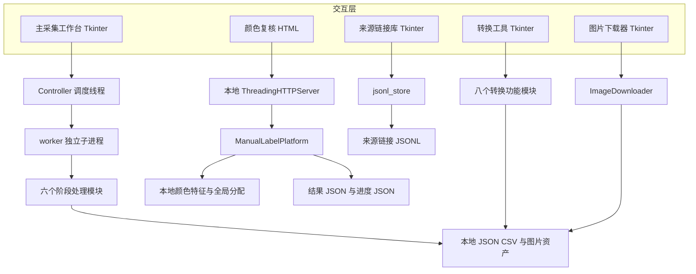
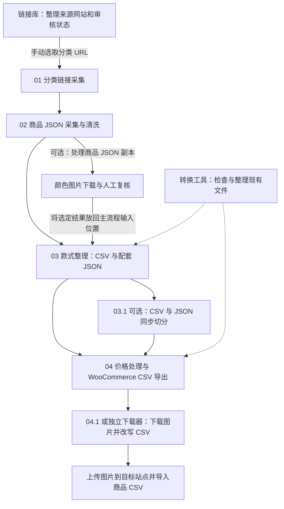
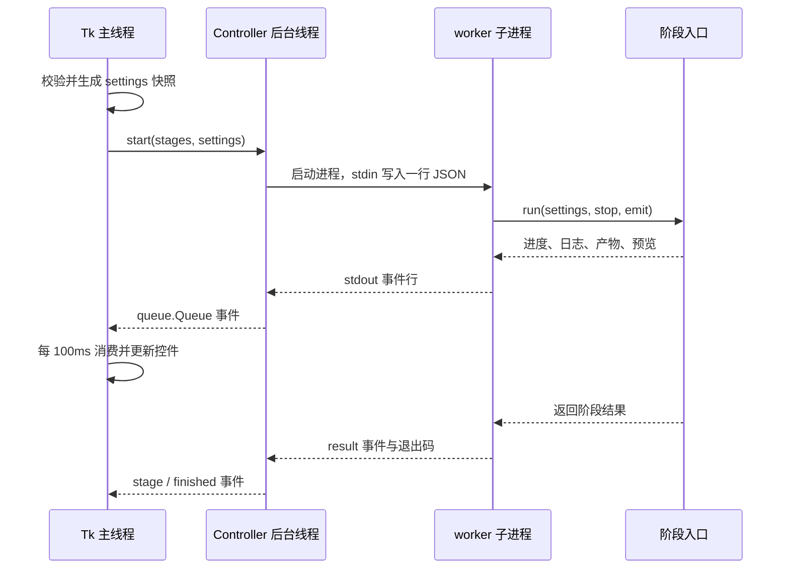

# oneStopWorkbenchForAnglan

**电商商品采集、数据治理与 WooCommerce 迁移工作台**

oneStopWorkbenchForAnglan 是一组以本地文件为数据交换载体的 Python 桌面应用与处理模块。系统面向 Shopify 风格商品源，将分类页面、商品 JSON、颜色图和商品选项整理为可定价、可分批交付的结构化数据，最终生成 WooCommerce 商品导入 CSV 与配套图片资产。

仓库包含一个分阶段采集工作台，以及来源链接管理、WordPress 图片下载、商品数据转换、颜色识别与人工复核四个子项目。主工作台负责组织商品处理链路，独立工具负责指定环节的数据维护，各入口可以分别运行。

本文以仓库现有实现为依据，覆盖部署要求、系统架构、数据契约、子项目内部结构、处理规则、文件副作用与恢复方式。路径未特别说明时相对于仓库根目录；`<项目目录>` 表示用户在工作台中选择的业务输出根目录。

### 业务能力与适用范围

| 业务环节 | 系统承担的职责 | 交付结果 |
|---|---|---|
| 来源准备 | 登记来源网站、分类、批次、审核状态与负责人 | 可追溯的 JSONL 来源链接库 |
| 数据获取 | 按分类收集商品链接，通过浏览器获取商品 JSON | 按域名组织的链接清单与商品汇总 JSON |
| 数据治理 | 清洗标题、描述、属性、尺码、币种及图片引用 | 统一商品对象和选项明细 |
| 人工复核 | 对颜色图提供本地识别建议，记录人工选择与确认 | 标注结果 JSON 与配套进度文件 |
| 商品编排 | 生成选项组合、按颜色拆行、按分类或批次切分 | 款式 CSV 与对应商品 JSON |
| 商业化处理 | 执行原价修正、库价分配、尺码梯度与 SKU 派生 | 价格结果表、未使用库价清单与 WP CSV |
| 资源准备 | 下载商品图片、转换格式、改写目标图片地址 | 本地图片资产、新 WP CSV 与失败清单 |

采集协议依赖 Shopify 风格的商品路径与 JSON 结构；支持自定义 XPath 仅扩展列表链接定位能力。WooCommerce 端的图片上传、在线商品查询与商品导入由使用者在目标环境完成。系统的运行边界是单机文件工作流，多个工具之间通过明确的输入文件衔接。

### 关键术语

| 术语 | 本项目中的含义 |
|---|---|
| 仓库根目录 | 包含本 README、`requirements.txt`、`Json Crawler system/` 和 `Utils/` 的代码目录 |
| 项目目录 | 一个店铺或处理批次的数据根目录，内部保存 `Json/`、`CSV/`、`原价/`、`价格匹配/` |
| 商品汇总 JSON | 阶段二生成的商品对象数组，包含描述、代表价格、图片与选项明细 |
| 十字段表 / style 表 | 十个业务列组成的历史格式；主流程另附 `md5`，当前共 11 列 |
| 独立商品 | 阶段三的一行商品记录；拆色后的每个颜色分组拥有独立身份 |
| 变体 | 独立商品内的选项组合，在 WooCommerce 中对应 `variation` 行 |
| WP CSV | 本项目输出或处理的 WooCommerce 商品导入 CSV |
| 进度侧车 | 与颜色标注结果同名配套的 `_progress.json`，记录分配来源和复核状态 |

## 阅读导航

- [子项目总览](#子项目总览)
- [系统架构与模块协作](#系统架构与模块协作)
- [环境安装与启动](#环境安装与启动)
- [目录结构](#目录结构)
- [推荐工作流程](#推荐工作流程)
- [主项目：商品采集与定价工作台](#主项目商品采集与定价工作台)
- [子项目：链接库](#子项目链接库)
- [子项目：WordPress 图片下载器](#子项目wordpress-图片下载器)
- [子项目：商品数据转换工具](#子项目商品数据转换工具)
- [子项目：商品颜色识别与复核](#子项目商品颜色识别与复核)
- [共享模块与数据约定](#共享模块与数据约定)
- [验证与常见问题](#验证与常见问题)
- [运行维护与数据恢复](#运行维护与数据恢复)
- [二次开发与变更影响](#二次开发与变更影响)

## 子项目总览

| 子项目 | 所在目录 | 主要用途 | 启动入口 |
|---|---|---|---|
| 商品采集与定价工作台 | [Json Crawler system](<Json Crawler system/>) | 分类链接采集、商品清洗、款式整理、切分、定价及 WooCommerce 导出 | `Json Crawler system/main.py` |
| 链接库 | [Utils/Assembly line](<Utils/Assembly line/>) | 按批次和分类管理来源网站，记录审核状态、审核人和备注 | `Utils/Assembly line/jsonl_gui.py` |
| WordPress 图片下载器 | [Utils/Image Downloader](<Utils/Image Downloader/>) | 从 WP CSV 下载图片，生成指向目标站点的新 CSV 和失败清单 | `Utils/Image Downloader/Image Downloader.py` |
| 商品数据转换工具 | [Utils/switch_tool](Utils/switch_tool/) | 价格库覆盖检查、WP 还原、SKU 维护、CSV 切分、图片链接精简、JSON 尺码调整 | `Utils/switch_tool/switch_gui.py` |
| 商品颜色识别与复核 | [Utils/Product color recognition](<Utils/Product color recognition/>) | 下载编号图片，以本地规则匹配颜色，浏览器内人工确认并保存 JSON | `download_images.py`、`color_matcher.py` |

另外，`Utils/workbench_ui.py` 和 `Utils/jsonl_store.py` 提供共享界面与数据存储能力。`Anglan_Crawler_Data/` 用于存放本机业务数据，已被 Git 忽略，新检出仓库时可以自行创建。

## 系统架构与模块协作

### 功能分层

系统按交互、调度、业务处理和持久化四类职责组织。主工作台通过子进程隔离各阶段，独立工具根据任务性质采用 GUI 后台线程或本地 HTTP 服务。



| 边界 | 交互方式 | 实现约束 |
|---|---|---|
| GUI → 主工作台调度器 | `Controller.start(stages, settings)` | 参数在提交时深拷贝；当前 GUI 每次提交一个阶段 |
| 调度器 → worker | 命令行传阶段号、停止文件；stdin 传一行 JSON 参数 | 子进程沿用当前 Python 环境，标准输出统一 UTF-8 |
| worker → GUI | stdout 事件行 → 调度队列 → Tk 主线程消费 | 后台处理不直接改写主工作台 Tk 控件 |
| 阶段 → 阶段 | 约定目录与文件格式 | 不会自动补跑缺失的前置阶段 |
| 独立工具 → 主工作台 | 人工指定或放置处理结果文件 | 输出格式、身份字段和扫描目录需要匹配 |
| 颜色前端 → 标注平台 | 本机 HTTP JSON 接口 | 仅绑定 `127.0.0.1` 的随机端口，页面与服务同源 |

### 共享代码与独立实现

| 能力 | 共享关系 | 维护含义 |
|---|---|---|
| 桌面工具主题与控件 | 链接库、独立下载器、转换工具共用 `Utils/workbench_ui.py` | 修改公共控件需复核三个窗口 |
| 链接数据读写 | 链接库使用 `Utils/jsonl_store.py` | 读写保护集中在存储模块 |
| 主工作台商品模型与清洗 | 阶段二和后续阶段使用 `common/` | 字段和清洗语义需沿处理链一致 |
| 图片下载 | 主工作台和独立下载器分别实现 | 超时、缓存校验、重试和停止语义存在差异 |
| 价格库 | 主定价库与转换工具检查库分别定义 | 调整其中一份不会同步另一份 |
| CSV 切分 | 主工作台与转换工具分别实现 | 主工作台有商品身份与 JSON 同步，独立工具按表格行处理 |
| 颜色平台页面 | Python 直接读取 `ui/index.html` | 发布时需要携带 HTML，无前端构建产物 |

### 数据生命周期与处理粒度

主工作台以域名为采集汇总边界，以独立商品为款式与定价单位，以变体为平台导出单位，以图片 URL 为 WP 图片下载去重单位。颜色识别的自动分配范围则限定在单个商品内部。

同一个来源 URL 在多个分类中出现时，采集阶段优先保留首次遇到的归类；同一个来源商品被阶段三拆成多个颜色分组后，会成为多个独立商品。价格、SKU 和切分均应按转换后的商品身份理解，不能只用来源 URL 推断它们必须合并。

## 环境安装与启动

### 运行要求

- **Python 3.10 或更新版本**。建议在仓库根目录创建独立虚拟环境。
- **Tkinter 与图形桌面**：主工作台、链接库、独立图片下载器、转换工具使用 Tkinter。
- **Chrome 或 Edge**：主工作台的链接采集、商品采集通过 DrissionPage 驱动 Chromium 系浏览器。浏览器自动探测路径按 Windows 常见安装位置配置；其他环境需显式指定浏览器路径。
- **本地代理**：两个浏览器采集阶段固定使用 `http://127.0.0.1:7897`，采集前需确保该代理可用。
- **普通浏览器**：颜色复核平台使用 Python 启动本地 HTTP 服务并打开浏览器，前端无需 Node.js 或构建步骤。

### 安装依赖

以下命令从仓库根目录执行，以 Windows PowerShell 为例：

```powershell
py -3 -m venv .venv
.\.venv\Scripts\python.exe -m pip install -r requirements.txt
```

直接使用虚拟环境解释器即可，不必先执行激活脚本。若使用已有 Python 环境，也可运行 `python -m pip install -r requirements.txt`，并将下面的解释器路径替换为 `python`。

| 依赖 | 项目中的作用 |
|---|---|
| `DrissionPage` | 采集阶段的浏览器控制、页面访问和网络响应监听 |
| `pandas` | 表格读取、合并、价格处理及独立图片下载器的 CSV 处理 |
| `openpyxl` | 转换工具的 XLSX 读取、生成与修改 |
| `requests` | WP 图片下载请求 |
| `certifi` | 商品采集网络模块的 HTTPS 证书链支持 |
| `lxml` | 根依赖清单中声明的 HTML/XML 解析库 |
| `Pillow>=9.1` | 图片读取、JPEG 转换、拼图和本地颜色分析 |

Python 标准库中的 `tkinter`、`csv`、`json`、`threading`、`concurrent.futures`、`http.server` 等模块无需通过 pip 单独安装。当前 `requirements.txt` 除 Pillow 下限外未固定依赖版本，也未提供依赖锁文件；迁移一个已验证的运行环境时，应同时记录 Python 与依赖版本。

独立图片下载器还会尝试加载可选的 `pillow-heif`，用于 HEIC/HEIF 解码；需要处理这类图片时再安装：

```powershell
.\.venv\Scripts\python.exe -m pip install pillow-heif
```

### 启动各工具

每条命令独立执行，均从仓库根目录启动：

```powershell
# 主采集工作台
.\.venv\Scripts\python.exe "Json Crawler system/main.py"

# 来源网站链接库
.\.venv\Scripts\python.exe "Utils/Assembly line/jsonl_gui.py"

# 独立 WordPress 图片下载器
.\.venv\Scripts\python.exe "Utils/Image Downloader/Image Downloader.py"

# 八合一商品数据转换工具
.\.venv\Scripts\python.exe "Utils/switch_tool/switch_gui.py"

# 颜色工具：先下载图片，再启动复核平台；不传路径时会提示输入
.\.venv\Scripts\python.exe "Utils/Product color recognition/download_images.py"
.\.venv\Scripts\python.exe "Utils/Product color recognition/color_matcher.py"
```

目录和文件名包含空格，命令中的路径需要保留引号。颜色工具接受命令行参数，其余上述入口直接启动桌面窗口。

### 首次部署验证

以下命令用于确认解释器、核心库与 Tk 可用，不会启动采集或修改业务数据：

```powershell
.\.venv\Scripts\python.exe --version
.\.venv\Scripts\python.exe -m pip check
.\.venv\Scripts\python.exe -c "import tkinter, requests, pandas, openpyxl, certifi, lxml, PIL, DrissionPage; print('imports OK')"
.\.venv\Scripts\python.exe -m tkinter
```

最后一条命令会打开 Tk 演示窗口，可用于确认 GUI 组件是否随 Python 正确安装。浏览器连通性需要在配置好固定代理后，通过主工作台采集一个分类、限制少量页面验证。单个解释器内的导入检查只验证基础环境，真实商品数据仍需经过对应阶段的输入校验。

### 网络与文件访问要求

| 组件 | 网络用途 | 本地读写范围 |
|---|---|---|
| 阶段一、二浏览器 | 分类页面、商品 JSON，固定走本地 7897 代理 | 当前项目目录；浏览器自身运行资源 |
| 币种与汇率模块 | 店铺币种与汇率 HTTP 查询，独立于浏览器请求 | 本机汇率缓存 |
| WP 图片下载器 | 图片源站的 HTTP / HTTPS 资源 | 输入 CSV 同目录的图片目录、新 CSV 与失败清单 |
| 颜色图片下载器 | 图片源站请求，自动生成 Referer | 输入 JSON、指定图片根目录 |
| 颜色复核平台 | 浏览器访问本机服务 | 原始 JSON、编号图片、结果与进度文件 |
| 链接库、转换工具 | 常规编辑与转换为本地文件处理 | 固定链接库或用户选取的表格 / JSON |

## 目录结构

```text
oneStopWorkbenchForAnglan/
├── README.md                            项目总说明
├── requirements.txt                     Python 依赖清单
├── .gitignore                           本机数据、虚拟环境、缓存等忽略规则
├── Json Crawler system/                 主采集与定价工作台
│   ├── main.py                          GUI 启动入口
│   ├── controller.py                    阶段调度与子进程管理
│   ├── worker.py                        单阶段子进程入口
│   ├── url_utils.py                     URL 工具兼容转发层
│   ├── app/                             设置、路径、常量与 URL 处理
│   ├── common/                          商品模型、清洗、编解码和原子写入
│   ├── ui/                              界面骨架、页面、参数校验与事件处理
│   ├── stages/
│   │   ├── 01_link_collector/           分类商品链接采集
│   │   ├── 02_product_scraper/          商品 JSON 采集与清洗
│   │   ├── 03_data_analysis/            款式组合与十字段表输出
│   │   ├── 03_1_split/                  CSV 与配套 JSON 同步切分
│   │   ├── 04_price_export/             价格处理与 WooCommerce 导出
│   │   └── 04_1_image_downloader/       集成式 WP 图片下载
│   └── README.md                        主工作台详细规则与文件说明
├── Utils/
│   ├── Assembly line/                   来源网站链接库
│   │   ├── jsonl_gui.py                 界面、录入与审核操作
│   │   ├── links.jsonl                  界面实际读写的链接数据
│   │   └── links.csv                    仓库中保留的 CSV 数据文件
│   ├── Image Downloader/
│   │   └── Image Downloader.py          独立下载核心与 GUI
│   ├── switch_tool/
│   │   ├── switch_gui.py               启动入口
│   │   ├── gui.py                      八个功能的统一界面
│   │   ├── constants.py                价格库、列名、默认参数
│   │   ├── utils.py                    表格、SKU、价格与转义工具
│   │   ├── theme.py                    主题配置
│   │   └── features/                   八个独立业务模块
│   ├── Product color recognition/
│   │   ├── download_images.py          图片下载、单色补图与拼图入口
│   │   ├── color_matcher.py            复核服务、标注与进度保存
│   │   ├── local_color_recognition.py  颜色特征与自动分配算法
│   │   ├── product_data.py             数据校验、路径、原子写与拼图
│   │   ├── ui/index.html               本地复核页面
│   │   └── README.md                   颜色工具使用与保存规则
│   ├── workbench_ui.py                 通用工作台控件与配色
│   └── jsonl_store.py                  安全读写 JSONL 链接库
└── Anglan_Crawler_Data/                 本机业务数据目录，可自行创建
```

运行后主工作台可能生成 `Json Crawler system/user_settings.json`。`.venv/`、`__pycache__/` 和 IDE 配置属于本机运行环境。

## 推荐工作流程



1. 在链接库登记来源网站、分类与审核结果，选出准备采集的分类 URL。链接库记录不会自动提交给主工作台。
2. 新建一个具体店铺或批次的数据目录，例如 `Anglan_Crawler_Data/demo-shop/`，在主工作台顶部选择它作为项目根目录。
3. 依次执行链接采集、商品采集、数据分析。需要人工核对颜色图或统一 JSON 尺码时，在生成最终款式表前处理商品 JSON。
4. 根据批次需求执行切分，再运行价格与导出。核对商品数量、定价状态、SKU 检查结果和失败清单。
5. 下载 WP CSV 中的图片，使用生成的新 CSV；将本地图片上传到 CSV 指向的目标 uploads 目录，再执行商品导入。下载工具只负责下载与改写链接。

主工作台界面每次执行当前选中的阶段，前置输入需要已经存在。仅需处理现有文件时，可直接使用独立工具。

## 主项目：商品采集与定价工作台

**目录：** `Json Crawler system/`。**入口：** `main.py`。详细业务规则见 [主工作台 README](<Json Crawler system/README.md>)。

### 项目根目录与设置

界面中的“项目目录”是业务数据的共同父目录，内部使用 `Json/`、`CSV/`、`原价/`、`价格匹配/` 等固定子目录。它可以位于仓库内部，也可以是另一个本地文件夹。

默认项目目录按以下顺序确定：

1. 环境变量 `ANGLAN_PROJECT_DIR`。
2. 本机设置里上次使用且仍存在的项目目录。
3. 仓库内已有的 `ANG_OUTPUT_XLSX/`。
4. 仓库根目录。

`Anglan_Crawler_Data/` 是可选的数据存放约定，不会因其存在就自动选中。可以在启动前显式指定：

```powershell
$env:ANGLAN_PROJECT_DIR = "D:/data/demo-shop"
$env:CHROME_PATH = "C:/Program Files/Google/Chrome/Application/chrome.exe"
.\.venv\Scripts\python.exe "Json Crawler system/main.py"
```

浏览器路径优先使用传入的 `browser_path`，其次是 `CHROME_PATH`，然后探测常见 Chrome、Edge 安装位置。`browser_path` 可填写在 `Json Crawler system/user_settings.json` 中。两个采集阶段的固定代理定义在 `app/constants.py`，历史自定义代理设置不参与浏览器配置。币种识别和汇率查询使用另行发起的 HTTP 请求，不能假定与浏览器采用相同代理。

本机设置会记住项目目录及部分功能开关；定价价差和流程开关需在运行前确认。

### 参数模型与默认值

参数由 `ui/build.py` 创建，`ui/dialogs.py::settings()` 校验后生成快照，再交给阶段入口。以下“记忆”表示启动任务时会写入本机 `user_settings.json`。

| 参数键 | GUI 默认值 | 语义与校验 | 记忆 |
|---|---|---|---|
| `project` | 按目录优先级推断 | 业务项目根目录，提交时转绝对路径 | 是，保存为 `last_project` |
| `categories` | 空文本 | 每行分类 URL 与可选标题 | 否 |
| `max_pages` | `0` | GUI 留空映射为不限；非空需为正整数 | 否 |
| `xpath` | 空 | 非空时改用 XPath 提取列表链接 | 否 |
| `browser_path` | 设置文件值或空 | 浏览器可执行文件路径，空值自动探测 | 是 |
| `skip_image_positions` | `[]` | `1` 表示首图，`-1` 表示末图；不接受 0，兼容中文逗号 | 否 |
| `use_standard_sizes` | `false` | 是否按现有尺码数量替换标准序列 | 是 |
| `keep_description_images` | `false` | 保留清洗后描述中的 `` | 是 |
| `keep_description_tables` | `false` | 保留清洗后的表格结构 | 是 |
| `options` | `[Color, Size]` | 参与组合的基本维度 | 否 |
| `include_other_options` | `false` | 按商品实际明细加入其他维度 | 是 |
| `option_limits.Color` | 不限 | 每个独立商品包含的颜色数，需为正整数 | 否 |
| `color_images_only` | `false` | 输出 Color 时，仅保留颜色引用图 | 否 |
| `gallery_image_limit` | `4` | 无输出 Color 维度时的补图数，非负整数；有 Color 时仍最多补 4 张 | 是 |
| `split_mode` | `parts` | `parts` 均分、`each` 按 title 独立输出 | 否 |
| `split_parts` | `2` | 均分份数，需为正整数 | 否 |
| `split_price_col` | `price1` | 均分时组内排序列 | 否 |
| `split_overwrite` | `true` | 是否覆盖同名切分结果 | 否 |
| `price_input` | 空 | 留空使用 `<项目>/CSV`，也可指定文件或目录 | 否 |
| `price_spread_percent` | `30` | 同商品最高 / 最低新价差百分比，范围 `[0,100]` | 否 |
| `window_lower`、`window_upper` | `0.75`、`1.25` | 候选窗口，满足 `0 < lower ≤ upper`，数值需有限 | 否 |
| `make_raw_prices` | `false` | 生成修正原价表并导出 WP | 否 |
| `match_prices` | `true` | 执行梯度匹配、库价统计并导出 WP | 否 |
| `image_csv`、`image_wp_site` | 空 | 待处理 WP CSV 与目标 HTTPS 地址 | 否 |
| `image_workers` | `8` | 图片下载线程数，GUI 限制 `1～50` | 否 |

运行中编辑参数会清空可能过期的预览，并提示“下轮生效”。当前任务仍使用提交时的快照。`settings()` 会同时校验公共表单参数，某些非当前页面的非法值也可能阻止提交。

切分价格列有一处实现细节：GUI 可传空字符串，但 `03_1_split/99_pipeline_entry.py` 会以 `price1` 回退。通过主工作台运行时，应按实际生效的排序列理解结果。

### 进程模型与事件协议

主工作台运行链路：



事件行以 `@@CRAWLER_EVENT@@` 开头，后跟单行 JSON；普通 `print()` 和合并后的 stderr 作为日志处理。示意：

```text
@@CRAWLER_EVENT@@{"kind":"progress","current":3,"total":10,"text":"处理商品"}
@@CRAWLER_EVENT@@{"kind":"artifact","path":"D:/data/demo/CSV/example.com_style.csv","text":"导出产物"}
@@CRAWLER_EVENT@@{"kind":"result","status":"success"}
```

| 事件 | 常用载荷 | 消费用途 |
|---|---|---|
| `progress` | `current`、`total`、`text` | 当前任务进度 |
| `stats` | `options`、`totals`、`products` | 选项数量和组合统计 |
| `preview` | `rows`、`total`、`missing` | 款式预览与缺图统计 |
| `artifact` | `path`、`text` | 本轮产生的文件或目录 |
| `log` | `text` | 运行日志 |
| `result` | `status`、可选 `message` | 阶段自报结果 |
| `stage`、`finished` | 阶段与最终状态 | 调度器补充的运行生命周期事件 |

worker 的 `emit()` 会立即 flush。调度器为事件补充阶段号，并结合退出码和最后的 result 判定结果；只有退出码为 0 且自报 `success` 才判定成功。截断或非法 JSON 事件行降级为日志。

每个 worker 只加载一个阶段，避免各阶段 `config`、`logger` 等兼容模块别名相互覆盖。`common/step_loader.py` 以“阶段目录 + 文件名”构造模块名，并缓存同一阶段模块实例。

### 停止与关闭机制

软停止通过临时停止文件跨进程传递：GUI 调用 `Controller.stop()`，worker 监听线程每 0.1 秒检查文件并设置阶段内 `threading.Event`。阶段在循环或步骤边界检查事件，尝试保存已完成结果。

强制结束先发送软停止并等待 10 秒，再调用 `terminate()`，继续等待最多 3 秒后调用 `kill()`。实际完成时间受正在进行的浏览器访问、网络请求和图片解码影响。临时停止文件放在本次任务的临时目录中，结束后清理，避免下一轮误读旧标记。

### 各阶段输入与输出

| 阶段 | 输入 | 输出与作用 |
|---|---|---|
| `01_link_collector` | 分类文本、页数、可选 XPath | 按域名生成 `Json/<域名>.csv`，保存分类索引 `Json/links_index.csv` |
| `02_product_scraper` | `Json/` 第一层域名 CSV，兼容同名 CSV 不存在时的旧 JSON | 采集并清洗为 `Json/Data Analysis/<域名>.json` |
| `03_data_analysis` | `Json/Data Analysis/` 的商品 JSON | 统计选项、预览组合，生成 `CSV/<域名>_style.csv` 与配套 `.json` |
| `03_1_split` | `CSV/*_style.csv` 与配套商品 JSON | 均分 N 份或按分类拆分，同时输出对应 JSON |
| `04_price_export` | 默认项目 `CSV/`，或指定 CSV 文件、目录 | 合并、可选原价修正、可选尺码梯度匹配、未使用库价与 WooCommerce CSV |
| `04_1_image_downloader` | WP CSV、目标 WordPress HTTPS 地址、线程数 | 本地图片、新 CSV、失败 URL 与 SKU 清单 |

`03_1_split` 的操作区在“数据分析”页中；界面上的图片下载页使用 `04_1_image_downloader`。运行时切分任务编号为 5、图片下载任务编号为 6，编号与侧栏页码并非一一对应。

### 阶段一：分类商品链接采集

分类文本每行一条，推荐填写“分类标题, URL”：

```text
Dresses, https://example.com/collections/dresses
Tops, https://example.com/collections/tops
```

默认从 Shopify 风格列表页提取 `/products/` 链接，按 `?page=N` 分页；也可提供 XPath。页数留空表示不限。输出域名 CSV 的表头是 `title,url,md5`，分类索引的表头是 `title,url`。续采合并已有链接，URL 归一后去重。索引和 recovery 文件不进入后续商品采集。

这部分围绕 Shopify 路径与商品 JSON 设计，其他站点即使能通过 XPath 收集链接，也需要核对阶段二是否能解析其商品数据。

**执行过程。** `parse_categories()` 提取每行首个 HTTP / HTTPS URL 和可选分类标题；`build_page_url()` 生成分页地址。默认链接提取同时检查页面 href、Shopify 元数据中的 handle，以及能与页面商品链接相互印证的 handle 片段。XPath 模式交由浏览器执行表达式并归一提取结果。

**分页终止。** 每个分类维护本分类已见链接集合，同时维护本次任务跨分类链接集合。达到页数上限、收到停止请求、页面无法加载，或非首页不再出现本分类新链接时停止该分类。首页无结果会进入重试；达到重试上限后记录失败并继续其他分类。单分类异常前已经完成的分页结果会保留。

**落盘行为。** 结束、停止或异常收尾时，按域名合并保存链接 CSV 并更新分类索引。已有域名 CSV 优先于同名旧 JSON；旧文件读取异常或无法正常合并时，恢复副本用于保留数据而非静默覆盖。阶段二会过滤索引文件和 `.recovery-` 文件。

| 运行常量 | 默认值 | 定义位置 |
|---|---|---|
| 首页最大重试数 `MAX_RETRIES` | `3` | `01_link_collector/00_config.py` |
| 首页重试等待 `RETRY_DELAY` | `2.0s` | 同上 |
| 页面稳定等待 `PAGE_SETTLE_WAIT` | `0.35s` | 同上 |
| 浏览器调试端口 | `9222～9322` 随机选择 | 同上及 `common/browser.py` |
| 浏览器启动重试 | `3` 次 | 同上 |
| 列表页图片加载 | 默认禁用 | 同上 |
| 浏览器会话 | 无痕 | 同上 |

**完成核对。** 检查域名 CSV 是否包含有效商品链接、索引是否包含本轮分类，并查看 `_stage01_failures.txt`。分类页打开成功但没有提取到商品，仍可能是页面结构或采集协议不匹配。

### 阶段二：商品采集、清洗与续采

将商品 URL 转成 Shopify 商品 JSON 地址，通过浏览器监听响应，整理为统一商品记录。主要处理包括：

- **标题和分类清洗**：标题保留文字、数字与空格，移除表情和标点；分类中的连字符替换为空格。
- **描述清洗**：处理脚本、链接、来源货号、SKU、产地语句、店铺政策、联系方式和重复段落。描述图片、表格默认删除，可单独开启保留。
- **选项归一**：统一 Color、Size 别名，整理颜色图与相册；支持按编号跳过图片。
- **尺码处理**：先执行基础清洗和支持的国家码转换；“使用标准尺码”开启时，按去重后的尺码数量套用标准序列。
- **价格处理**：售价与划线价互补，识别币种并尝试换算 USD；失败时保留原数值及原币种。
- **断点续采**：完整记录跳过，缺失数据或保留模式变化时补采；成功结果按批次原子保存。

标准尺码开关默认关闭。开启后是按数量重建尺码序列，例如三个尺码输出 `S、M、L`，不能把它理解为保留原尺码含义的换算。已删除的描述图片、表格及已替换的原尺码无法从清洗结果恢复，需要重新采集。

汇率缓存有效期为 24 小时，Windows 默认保存在 `%LOCALAPPDATA%/AnglanWorkbench/exchange_rates.json`。保存按成功记录数达到 10 条，或处理检查点距上次保存满 15 秒触发；停止和结束时尝试保存余下记录。

#### 商品价格、图片和原始信息的提取

商品代表售价和划线价分别从原始变体价格中取众数，再执行缺失互补与币种换算。因此，商品汇总 JSON 保留的是商品级代表两价；源站逐个变体的差异价格没有完整保存在当前汇总模型中。阶段三依据此代表两价生成组合，阶段四再按本项目规则重新定价。

颜色图通过颜色选项所在的 `optionN` 与变体 `image_id` 关联，按每个颜色首个可用图建立映射；无法关联时保留空链接。图片先按来源 `position` 排序，再应用完整相册编号的跳图设置。已作为颜色图引用的地址从普通相册中分开管理。

#### 尺码标准化的两层规则

第一层始终执行基础清洗：选项名归一、括号注释清理、字母尺码后的数字后缀处理、支持的国家码前缀转换，以及保序去重。例如 `XS(US 4)` → `XS`，`L/10-12` → `L`；支持 `US/UK/AUS/FR/ITY`，未匹配的值保留基础清洗结果。

第二层仅在标准尺码开关开启时执行，直接按清洗后的取值数量重建整组：

| 尺码数量 | 标准输出 |
|---:|---|
| 1 | `One Size` |
| 2 | `S, M` |
| 3 | `S, M, L` |
| 4 | `S, M, L, XL` |
| 5 | `S, M, L, XL, 2XL` |
| 6 | `XS, S, M, L, XL, 2XL` |
| 7 | `XS, S, M, L, XL, 2XL, 3XL` |
| 8 | `XS, S, M, L, XL, 2XL, 3XL, 4XL` |
| 9 | `XXS, XS, S, M, L, XL, 2XL, 3XL, 4XL` |
| 0 或大于 9 | 保留基础清洗后的取值 |

数量规则不依据商品标题判断品类，例如数字鞋码也会在开关开启时按数量替换。国家尺码的详细映射、加宽码冲突处理见主工作台专用说明和 `common/option_values.py`。

#### 描述清洗策略

描述处理分为 HTML 结构清理和商品政策内容清理。图片、表格保留开关只决定这些结构是否保留，来源货号、联系方式、政策和引流规则仍继续执行。

| 处理对象 | 当前策略 |
|---|---|
| 脚本、视频、资源与元信息、注释 | 清理相应内容或结构 |
| 普通 HTML 属性 | 剥离；保留图片时只保留 `src`，不自动提升 `data-src` |
| 表格 | 默认删除；保留时维护表格结构及必要的跨行 / 跨列属性 |
| SKU、产地句、Product ID / SPU / Article number | 按元素、句段及跨行内标签规则清理来源标识 |
| 运费、配送、税费、退款、支付、隐私等政策 | 按段落和政策标题范围删除 |
| 邮箱、来源店铺域名、社交媒体引流 | 结合原始 HTML 与文本清理对应段落或入口 |
| 重复段落与重复详情块 | 忽略普通行内排版差异，保留首次有效内容 |
| 纯 FAQ / 政策页 | 无有效商品内容时清空描述 |

关键词扫描器 `scan_description_keywords()` 以 `DESCRIPTION_KEYWORDS` 的 48 项规则检查 HTML 和合并后的正文。需要调整清洗策略时，应以真实保留内容和误删风险共同核对规则，不能只检查某个关键字是否消失。

#### 续采决策与提交机制

| 历史记录状态 | 本轮行为 |
|---|---|
| 结构完整，模式无需恢复 | 跳过网络请求，必要时应用可直接完成的清洗修复 |
| 选项数量存在但有效明细缺失 | 重新请求商品，恢复明细 |
| 开启标准尺码且已有完整尺码明细 | 可直接按数量修正并标记 `standard` |
| 已标准化记录切回原值模式 | 重新请求，成功保存后替换旧记录 |
| 描述图片 / 表格从删除改为保留 | 重新请求已丢失的来源内容 |
| 描述图片 / 表格从保留改为删除 | 可直接清洗现有描述 |
| 历史文件结构非法或规范化 URL 对应不同内容 | 报告错误并保护原文件 |

运行器区分待提交记录 `pending` 与确认写入的 `committed_rows`。达到批次阈值后，将候选全量汇总写入同目录临时文件，再原子替换域名 JSON；只有替换成功才更新已提交状态。保存失败时不把内存中的新结果计入已提交成果。

| 运行参数 | 默认值 | 作用 |
|---|---|---|
| 相邻商品间隔 | `0.5s` | 控制同店铺请求节奏 |
| 瞬时失败重试等待 | `10s` | 非 200 或空结果时重试一次 |
| JSON 响应监听期限 | `30s` | 监听循环期限；页面访问本身另有浏览器行为 |
| 批量提交阈值 | `10` 个成功商品 | 达到后尝试刷盘 |
| 提交时间检查阈值 | `15s` | 到达处理检查点后判断，不是独立后台定时器 |
| 汇率缓存有效期 | `24h` | 复用本机缓存 |
| 汇率失败重试间隔 | `5min` | 限制失败后的重复请求频率 |

### 阶段三：选项组合与款式表

默认以 Color、Size 生成组合，其他维度需开启参与。可以统计和预览选项组合、限制每行颜色数，并调整无 Color 商品的相册补图数量。预览最多展开前 200 个组合。

颜色超过上限时拆成多个独立商品行，每个颜色分组生成稳定的新 `md5`；配套 JSON 与该 CSV 的颜色、图片和身份对应。`styles1` 保存变体属性、两价与图片，过长的款式串会跳过并记入失败清单。

项目沿用“十字段表”称呼，**当前阶段三输出实际为十个业务字段加 `md5`，共 11 列**。字段说明见下方[数据约定](#共享模块与数据约定)。阶段三不执行换汇，表格也不含币种列，生成前需核对阶段二的 `currency`。平台导出最多保留三个选项维度，选择组合时应控制维度数。

**组合算法。** 先对选项名、选项值及跳过维度做归一，Color 优先排列，再根据勾选列表选择维度，并以笛卡尔积生成组合。组合总数为各维度取值数量的乘积。预览利用惰性迭代只展开前 200 个，完整导出仍需构造实际款式内容。

**其他维度。** 开启“其他维度参与组合”后，`ships from` 等被排除名称仍不参与。多值列表形式的 `Type` 输出为 `Style`；单值 `Type` 不执行重命名，且当前其他维度的勾选映射不会使它加入组合。

**拆色身份。** `color_product_md5()` 以 `color-product-v1`、来源身份和排序后的颜色名生成 MD5；不使用价格、图片地址或颜色块序号。相同颜色集合重复导出身份稳定，改变颜色分组会改变独立商品身份。

**图片输出。** 款式颜色图优先保留并去重，再补相册图；实际拆成多个颜色块时强制只保留该块的颜色图。图片路径有扩展名且尚未包含目标尺寸后缀时，插入 `_600x600`，适用于 Shopify CDN 缩放约定。

**导出约束。** `styles1` 上限为 32000 字符，超过时跳过该商品并记录失败，不截断生成损坏的款式串。CSV 和配套 JSON 按域名输出，写入分别原子替换；两份文件并非一起事务提交。

### 阶段 3.1：同步切分 CSV 与 JSON

支持两种模式：

- **均分 N 份**：按 `title` 分类分组，可按 `price1` 或 `price2` 排序，以独立商品 `md5` 为单位轮询分配。
- **按 title 各自成文件**：每个分类输出一组 CSV 与 JSON。

配套 JSON 优先来自阶段三输出的同名 `.json`，历史文件兼容从 `Json/Data Analysis/` 查找。找不到 JSON 时仍可切分 CSV；找到了 JSON 但缺少所需 `md5` 时会报告失败。取消覆盖后，CSV 和 JSON 一起选择未占用的新名称。

均分输出示例：

```text
CSV/
├── example.com_style_1/
│   ├── csv/example.com_style_1.csv
│   └── json/example.com_style_1.json
└── example.com_style_2/
    ├── csv/example.com_style_2.csv
    └── json/example.com_style_2.json
```

**分配粒度。** 均分先按分类组织输入，在分类内将连续相同 `md5` 的行视为一个商品块，再按块首行价格排序，使用跨分类累加的轮询计数分配。阶段三正常输出每行一个独立商品；若手工扩展为多行，同身份行应保持相邻，分散在不同位置的同 `md5` 不会被全局重新聚合。“均分”不保证各文件行数绝对相同，拆色后的不同 `md5` 可以进入不同批次。

**JSON 匹配。** 切分结果记录每份 CSV 的 `md5` 集合，再从配套商品 JSON 建立身份索引并筛选对象。存在 JSON 却缺少任一所需身份时报告失败；已经生成的 CSV 可能保留，因此需核对 CSV / JSON 是否配套。

**覆盖规则。** 取消覆盖时，CSV 与 JSON 一起检查目标名是否可用，统一追加 `_新`、`_新2` 等后缀；最终以排他创建方式写入，防止检查后目标被占用时覆盖既有文件。按分类输出时会清理非法文件名字符并处理清理后的重名。

### 阶段四：价格处理与 WooCommerce 导出

目录输入会递归收集 CSV，过滤已知结果目录、合并表、隐藏文件等；检测到切分产物时优先使用切分文件。应将本轮需要处理的表放在明确的输入目录。

| 原价表开关 | 价格匹配开关 | 执行结果 |
|---|---|---|
| 开 | 开 | 合并、原价修正、梯度匹配，分别导出两套 WP CSV |
| 开 | 关 | 合并、原价修正并导出 WP CSV |
| 关 | 开 | 合并、梯度匹配并导出 WP CSV |
| 关 | 关 | 合并后直接转换成 WP CSV |

原价修正将低于售价的划线价抬到售价，同时处理款式串内嵌价格。梯度匹配以采集划线价为参考，缺失时使用售价；默认候选窗口为参考价的 `0.75～1.25`，同款梯度价差上限为 `30%`。当前主流程价格库包含 232 档，范围为 `8.99～599`。

普通匹配先按参考价从高到低分配库价。候选窗口经过已用价格过滤和价差约束后，有尺码商品按档位数量执行选档，再将同尺码价格应用到不同颜色。低价商品、售价低于划线价五折的商品、无尺码商品各有独立规则，具体见下文。

导出格式为 WooCommerce 商品 CSV，包含 `variable`、`variation` 或 `simple` 商品类型；有效折扣写入 `Sale price`、`Regular price`，无折扣时仅写正常价。SKU 根据商品 `md5` 确定性派生，导出后检查当前文件内重复 SKU 和孤立变体，检查结果写日志。

#### 输入收集与文件副作用

`10_merge.py` 负责单文件读取或目录合并。目录模式按列名对齐，列不一致时提示并为空缺列留空，合并前不会自动判断每张表是否属于同一业务批次。

| 输入方式 | 合并表位置 | 后续输出基准 |
|---|---|---|
| `<项目>/CSV/` 目录 | `<项目>/CSV/<项目名>_合并.csv` | `<项目>/` |
| 其他目录 | `<输入目录>/<目录名>_合并.csv` | 输入目录 |
| 单个 CSV | 输入文件自身 | 所在目录；目录名为 `CSV` 时上移一级 |

单文件模式会补齐缺失 `md5` 并将整理后的表写回输入文件，不额外生成合并副本。缺失身份优先根据 `link-href` 计算 MD5；仅当整列 `link-href` 不存在时，才尝试用 `src_links` 第一段作为回退来源。

目录递归时排除 `原价/`、`价格匹配/`、`json/`、本轮规范合并表、指定规范名表、隐藏文件和 `~$` 锁文件。若输入目录第一层存在匹配 `_style_N/` 或 `_style_按title拆分/` 的切分目录，会跳过该层原始 `*_style.csv`。这是目录级判断，准备输入时应按同一批次组织各域名与切分结果。

#### 梯度价格分配规则

设参考价为 `r`，窗口系数为 `a,b`，价差百分比为 `s`，库价集合为 `L`，当前任务已使用价格集合为 `U`：

```text
参考价 r = 有效采集划线价，否则为有效采集售价
窗口候选 C = { p ∈ L | r × a ≤ p ≤ r × b，且 p ∉ U }
价差约束 = max(C) ≤ min(C) × (1 + s / 100)
```

金额转换为整数分计算边界和占用集合，参考窗口边界按 `ROUND_HALF_UP` 转分，价差上限向下取整。普通候选先按窗口最低未用库价确定上限并剔除过高档位，再执行选档。

| 优先顺序 | 条件 | 处理行为 | 定价状态 |
|---:|---|---|---|
| 1 | 采集售价可解析且低于 `8.99` | 按售价升序，循环分配 `8.99～19.99` 之间的库价；同商品全部变体同价，不设折扣 | `低价` |
| 2 | 普通处理行无有效正参考价 | 保留输入行，记录原因 | `未匹配` |
| 3 | 有效采集划线价大于 0，采集售价低于其 50% | 保持输入价格与款式，采集售价计入已用价格 | `未匹配` |
| 4 | 款式串无法解析 | 保留输入行，提示修正数据 | `未匹配` |
| 5 | 没有实际尺码且候选非空 | 取最小未用候选，全部变体同价 | `原价` |
| 6 | 有实际尺码且候选非空 | 根据尺码顺序分配梯度，见下表 | `已匹配` |
| 7 | 无候选库价 | 参考价作为正常价，各变体不设折扣 | `未匹配` |

低价处理先执行；其余行按参考价降序分配，参考价缺失的行排在最后。价格占用范围是**本次 `run()` 的输入集合**，不跨独立运行、不查询店铺在线价格，也不读取历史任务作为全局库存。低价池可以循环重复，其已用档位会影响后续普通分配。

对有尺码商品，设去重后的尺码数为 `N`，经过过滤的候选数为 `K`：

| 候选数量 | 当前实现的选档方式 |
|---|---|
| `K > N` | 跳过最低一档，从第二档起取 N 档 |
| `K = N` | 使用全部 N 档 |
| `0 < K < N` | 前 K 个尺码各取一档，后续尺码复用最后一档 |

尺码先按标准字母序列、扩展 XL、数字、其他文本排序。相同尺码跨颜色共价；行级 `price1` 取已选最低档，`price2` 取最高档；每个款式段的售价对应本尺码，划线价对应本商品最高档。最高尺码售价等于划线价，WP 导出时该变体不形成折扣。

例如，假定过滤后的候选为 `31.52, 31.95, 31.99, 32.14, 32.24`，商品尺码为 S/M/L，则 `K > N`，实际选档是 `31.95, 31.99, 32.14`；若仅有两档 `31.52, 31.95`，则分配为 `31.52, 31.95, 31.95`。示例假设这些档位尚未被本轮其他商品占用。

匹配表保存 `采集售价`、`采集划线价`、`采集款式`、`定价参考价`、`定价状态`。续跑匹配时优先保留已有采集依据列；原价修正分支只修正当前两价倒挂，不会利用这些采集依据列自动恢复原始价格。需要采集原价导出时，应选原始 style 输入。

#### WooCommerce 映射与身份派生

`14_export_wp.py` 将每个独立商品转换为一个 `simple` 行，或一个 `variable` 父行加多个 `variation` 子行。判断依据是款式中是否存在实际选项值，父商品必须先于其变体写出。

| style 信息 | WP 信息 | 当前行为 |
|---|---|---|
| `name`、`title`、`details` | `Name`、`Categories`、`Description` | 直接映射商品名称、分类和描述 |
| `styles1` | 三组 Attribute name / value(s) | 从款式段展开，最多三个选项维度 |
| 商品与变体价格 | `Sale price`、`Regular price` | 仅 `0 < 售价 < 划线价` 时输出折扣，否则售价写正常价 |
| `src_links` 与款式图片 | `Images` | 归一横杠，按商品树汇总并去重 |
| `md5` 与变体序号 | `SKU` | 确定性派生，见下文 |
| 商品父子关系 | `Type`、`Parent`、`Position` | 建立父 SKU 引用与变体位置 |
| 发布、库存 | `Published=1`、`In stock?=1`、`Stock=99999` | 使用导出器固定默认值，未读取源站实时库存 |

父 SKU 格式为 `SKU` 加 8 位数字，由商品身份及碰撞计数器派生；变体 SKU 格式为 `5-5-5`，由商品身份和变体序号派生。同身份、同组合顺序、同输入集合通常保持稳定；改变选项顺序、商品身份或引入碰撞可能影响结果。当前文件内去重只保证本文件可区分，不保证与线上历史商品身份自动合并。

当前 WP 表头包含 26 列，不输出 `md5`、币种、来源 URL、清洗模式或颜色复核状态。跨平台往返所损失的信息见后文数据契约。

导出完成后，`check_wp_skus()` 检查非空 SKU 重复和孤立 Parent，只报告统计与有限明细，不自动修复，也不会仅因发现这两类问题而将导出判为失败。

### 阶段 4.1：集成式图片下载

在主工作台中选取 WP CSV 和目标 HTTPS 站点。程序对 `Images` 列拆分去重、并发下载，成功后替换对应链接，失败链接保留原值。可以在界面查看进度并请求停止。图片转换、输出目录与新 CSV 的基本用途与下文独立图片下载器相同，两者由各自模块实现。

业务入口为 `run_download(csv_path, wp_site, workers, stop, emit)`。输入必须是现有 `.csv` 文件并包含精确的 `Images` 列，目标地址必须具有 HTTPS 协议和有效主机名；实际只将 HTTP / HTTPS 图片地址加入下载任务，其他单元格条目保留原值。

| 处理环节 | 集成实现行为 |
|---|---|
| 去重与缓存 | 按完整 URL 去重；非空 `<URL-MD5>.*` 命中缓存，零字节缓存删除；不重新完整解码缓存 |
| 网络重试 | 每 URL 最多尝试 3 次；`408/425/429` 及 `5xx` 可重试，间隔 2 / 4 秒；其他小于 500 的非 200 响应提前停止 |
| 图片校验 | 标准环境用 Pillow 完整加载；有效 JPEG 可沿用字节，其他格式转 JPEG，透明区域合成白底 |
| 错误分类 | 网络和文件异常可重试；无法解码的图片不在本轮继续尝试 |
| 文件提交 | 图片以临时 `.part` 写后替换；全部任务收尾后原子生成新 CSV |
| 失败关联 | 生成失败 URL 清单；有 SKU 列时，按 `Parent` 优先、否则 `SKU` 关联失败商品 |
| 停止边界 | 待执行请求在检查停止事件时退出；正在请求的任务需等待返回，结束后仍保存已完成映射 |
| 结果状态 | 已请求停止优先返回 `stopped`；否则存在失败为 `partial`，无失败为 `success` |

任务会一次提交全部唯一 URL 到线程池，因此停止不等于立即取消所有 Future。没有有效 HTTP 图片 URL 时仍可生成新 CSV；这与独立下载器的提前返回行为不同。停止导致尚未下载的 URL 不计入普通下载失败清单，应结合 `stopped` 状态判断剩余工作。

### 典型业务数据目录

目录输入为项目 `CSV/`、原价与匹配均启用时：

```text
<项目目录>/
├── Json/
│   ├── example.com.csv
│   ├── links_index.csv
│   └── Data Analysis/example.com.json
├── CSV/
│   ├── example.com_style.csv
│   ├── example.com_style.json
│   ├── <项目名>_合并.csv
│   └── example.com_style_1/              可选切分产物
├── 原价/
│   ├── <项目名>_合并_原价.csv
│   └── wp-<项目名>_合并_原价.csv
└── 价格匹配/
    ├── <项目名>_合并_价格匹配.csv
    ├── <项目名>_合并_未匹配到的价格.csv
    ├── wp-<项目名>_合并_价格匹配.csv
    ├── wp-<项目名>_合并_价格匹配-images/   执行图片下载后生成
    └── wp-<项目名>_合并_价格匹配-imageOK-<时间戳>.csv
```

单文件价格输入以输入文件 stem 命名；名为 `CSV` 的目录以父目录为输出基准，其他目录以自身为基准。未启用的流程不会新建对应结果目录。

### 主工作台文件职责

| 文件或目录 | 维护职责 |
|---|---|
| `main.py` | 创建 Tk 根窗口并进入事件循环 |
| `controller.py` | 后台调度、启动 worker、转发日志和事件、软停止与强制结束 |
| `worker.py` | 从 stdin 读取参数，只加载一个阶段，通过标准输出回传结构化事件 |
| `app/constants.py` | 阶段名称、状态、事件前缀、固定代理 |
| `app/project_paths.py`、`app/user_settings.py` | 默认业务路径与本机设置读写 |
| `app/url_utils.py`、顶层 `url_utils.py` | URL 横杠与编码归一；顶层文件负责兼容转发 |
| `ui/app.py`、`ui/build.py` | 组合界面类、窗口骨架、变量与样式 |
| `ui/pages.py`、`ui/dialogs.py` | 各页面布局、目录选择、参数快照与校验 |
| `ui/runtime.py` | 启停操作、主线程事件消费、日志与关闭流程 |
| `ui/theme.py`、`ui/glass.py` | 字体、配色、圆角和控件素材 |
| `common/product_model.py` | `Product`、`OptionDimension` 模型、字段校验与序列化 |
| `common/product_text.py`、`common/option_values.py` | 标题、分类、颜色及尺码值清洗 |
| `common/description_html.py`、`common/description_policy.py` | 描述 HTML、货号、店铺政策与重复内容清洗 |
| `common/price_fallback.py`、`common/styles_codec.py` | 两价互补、款式串的转义与对称编解码 |
| `common/browser.py` | 浏览器探测、启动、代理、随机调试端口与重试 |
| `common/atomic_io.py`、`common/stop.py` | 原子替换文件、统一停止检查 |
| `common/step_loader.py` | 按路径加载数字前缀模块，并登记兼容模块别名 |
| 各包 `__init__.py` | 包标记或包说明 |

各阶段内文件进一步分工：

| 阶段目录 | 文件职责 |
|---|---|
| `01_link_collector/` | `00_config.py` 配置；`20_browser.py` 页面与 XPath 封装；`30_collector.py` 分类解析、分页及提取；`40_file_utils.py` 合并保存；`80_logger.py` 日志；`99_pipeline_entry.py` 阶段接口 |
| `02_product_scraper/` | `00_config.py` 配置；`20_browser.py` 浏览器封装；`25_file_utils.py` 目标读取与 JSON 保存；`30_network.py` JSON 请求、币种及汇率；`40_product_analysis.py` 商品解析；`50_scraper_runner.py` 续采、重试与批量保存；`80_logger.py` 日志；`99_pipeline_entry.py` 阶段接口 |
| `03_data_analysis/` | `00_config.py` 列名和限制；`10_option_split.py` 拆色与身份派生；`30_product_parser.py` 组合加载器；`31_parser_part1.py`、`32_parser_part2.py` 选项、图片和款式解析；`40_analyzer.py` 统计与批量整理；`99_pipeline_entry.py` 预览和导出接口 |
| `03_1_split/` | `00_config.py` 默认列与模式；`20_split.py` CSV 分组、商品分配及 JSON 同步；`99_pipeline_entry.py` 输入收集与执行接口 |
| `04_price_export/` | `00_pricing_config.py` 库价与规则；`10_merge.py` 输入合并；`11_fix_prices.py` 原价修正；`12_match_prices.py` 梯度匹配；`13_unused_prices.py` 未使用库价；`14_export_wp.py` WP 格式和 SKU；`80_styles_utils.py` 款式价格解析；`90_pipeline.py` 流程编排；`99_pipeline_entry.py` 阶段接口 |
| `04_1_image_downloader/` | `20_downloader.py` 下载、转图、改写 CSV 与失败清单；`99_pipeline_entry.py` 参数接入 |

调用关系为 `main.py → ui → controller.py → worker.py → 阶段入口`。阶段入口统一提供 `run(settings, stop, emit)`。数字前缀文件通过 `step_loader` 加载，阶段依赖的 `config` 等别名由入口登记；日常使用应运行主入口。

## 子项目：链接库

**目录：** `Utils/Assembly line/`。**入口：** `jsonl_gui.py`。

用于管理准备审核或采集的来源网站。界面按“批次 → 分类 → 链接”浏览，支持搜索与状态过滤、查看详情、复制链接，以及批量设置审核状态、备注和审核人。新链接默认为“未使用”，预设状态包括“已送审”“审核未通过”“通过”“404”“量少”等，也支持自定义状态。

### 录入与去重

先填写批次，再在新增页面逐行输入“链接 空格 分类”：

```text
https://example.com 女装
https://another.example/collections/shoes 鞋类
```

兼容旧式 `id link type` 输入，但保存时重新自动编号。去重按规范化的域名和路径比较：域名转小写并去掉 `www.`，路径去掉末尾 `/`，忽略协议、查询参数和片段；路径大小写仍参与比较。

### 数据与文件

| 文件 | 作用 |
|---|---|
| `jsonl_gui.py` | 界面、浏览树、输入解析、去重与审核字段更新 |
| `links.jsonl` | GUI 固定读写的数据文件，每行一个 JSON 对象 |
| `links.csv` | 仓库保留的数据文件，当前 GUI 不读取或同步它 |
| `../jsonl_store.py` | JSONL 读取、损坏行保留、外部改动检测与原子保存 |

记录示意：

```json
{"id":"00001","batch":"demo-batch","type":"女装","link":"https://example.com","status":"未使用","created_at":"2026-11-26 10:00:00","updated_at":"2026-11-26 10:00:00","note":"","approver":""}
```

存储层只将合法对象交给界面编辑，损坏行和空行会保留；保存含损坏行的源文件时先创建 `.bak` 备份。读取后若文件被其他程序修改，会拒绝覆盖并提示重新打开。

### 记录字段与更新语义

| 字段 | 类型 | 创建与更新规则 |
|---|---|---|
| `id` | 字符串 | 依据当前可解析最大数字 ID 加一，至少补齐五位；不使用输入中的旧 ID |
| `batch` | 字符串 | 录入时指定批次，用于第一层分组 |
| `type` | 字符串 | 链接分类，用于第二层分组 |
| `link` | 字符串 | 原输入链接保留，另用规范化键判断重复 |
| `status` | 字符串 | 创建为“未使用”；可设置预设或自定义状态 |
| `created_at` | 字符串 | 创建时的本机时间，格式 `YYYY-MM-DD HH:MM:SS` |
| `updated_at` | 字符串 | 创建、批量状态、备注或审核人操作时更新 |
| `note` | 字符串 | 备注，可批量写入 |
| `approver` | 字符串 | 审核人，可批量写入 |

界面状态用于业务标记，没有强制的状态流转图；使用者可从任一状态改为其他状态。当前文件保存最后的状态和更新时间，没有追加式审核历史。`batch/type` 构建浏览树，ID 在批量更新中用于关联所选记录，外部维护数据时需保证其唯一。

### 存储实现与冲突处理

`JsonlRecords` 继承列表，额外保存原始行布局、损坏行号、源摘要与备份路径。读取时将合法 JSON 对象变为可编辑记录，将无法解码、非对象或不合法 JSON 的原始字节保留为不可编辑行。保存时按原布局序列化仍存在的记录，再追加新记录。

存储流程为：序列化 → 校验源 SHA-256 → 必要时备份损坏源文件 → 同目录写临时文件并 `fsync` → 再次校验源摘要 → `os.replace()`。损坏源备份按 `links.jsonl.bak`、`.bak2` 等递增命名，不覆盖既有备份。

摘要检查可以发现读取后已发生的外部修改，但没有跨进程文件锁。该工具适合单写入者维护；保存冲突后应重新打开读取最新数据。自动备份只针对含损坏行的输入，并非每次修改都会生成版本快照。

### 典型操作与结果核对

先创建批次并批量录入，查看新增、重复和无效行统计，再进入分类列表筛选待审核链接。选择记录后批量设置状态、审核人或备注，检查详情和状态栏确认保存结果。准备采集时复制业务所需的分类 URL 到主工作台。

链接库与采集目标文件的数据层级不同：链接库保存待审核来源，阶段一 CSV 保存已提取的商品地址。两者不会自动互相覆盖。

## 子项目：WordPress 图片下载器

**目录：** `Utils/Image Downloader/`。**入口：** `Image Downloader.py`。

用于处理已经生成的 WooCommerce CSV，也可以单独处理包含 `Images` 列的 CSV。界面填写 CSV 路径、目标 WordPress HTTPS 地址和 `1～50` 个下载线程。

### 处理规则

1. 以字符串读取 UTF-8 / UTF-8 BOM CSV，提取 `Images` 列中以逗号分隔的图片 URL 并去重。
2. 使用 URL 的 MD5 作为文件名，并发下载，失败时重试；首轮结束后默认再补采一轮。
3. 安装 Pillow 时校验并转换为 JPEG，透明图片使用白底。文件名统一为 `<URL-MD5>.jpg`。
4. 将成功图片的链接替换为 `<目标站点>/wp-content/uploads/<运行年份>/<运行月份>/<文件名>`。
5. 另存新 CSV，保留下载失败的原始链接，并按失败情况输出 URL / 商品 SKU 清单。

输出示例：

```text
<原 CSV 所在目录>/
├── wp-demo.csv
├── wp-demo-images/
│   ├── <图片URL的md5>.jpg
│   ├── failed_images.txt                有失败时生成
│   └── failed_skus.txt                  有可关联的失败商品时生成
└── wp-demo-imageOK-<时间戳>.csv
```

有 `SKU` 列时可关联失败商品；变体图片失败时优先记录其 `Parent`。图片下载完成后，需要自行将图片上传到生成链接对应的目录，目标站点域名和年月路径应与上传位置一致。

### 文件内结构与集成功能的关系

`ImageDownloader` 类负责下载、重试、图片转换、链接替换和结果保存；`ImageDownloaderGUI` 类负责 Tkinter 界面与进度展示。业务类通过日志与进度回调向外提供状态。

主工作台的 `04_1_image_downloader/20_downloader.py` 是另一份集成实现，使用主工作台的停止和事件协议。修改下载规则时需分别核对两份实现。

### 核心调用与运行参数

业务类入口为 `ImageDownloader(...).run()`；GUI 通过后台线程运行，并注入 `log_callback(message)` 与 `progress_callback(current, total, message)`。核心配置含义如下：

| 构造参数 | 默认值 / 要求 | 行为 |
|---|---|---|
| `csv_file` | 必填 | UTF-8 / BOM CSV，必须有精确的 `Images` 列 |
| `wp_site` | 必填 | 目标站点；GUI 要求以 `https://` 开头 |
| `download_workers` | GUI 初始 `20`，限制 `1～50` | 线程池并发数 |
| `max_attempts` | `3` | 单 URL 每轮最大尝试数 |
| `retry_rounds` | `1` | 首轮结束后的失败补采轮数 |
| `retry_wait` | `5s` | 补采轮次前等待 |
| `only_urls` | `None` | 核心类可限制到指定 URL 集合 |
| `image_dir` | 自动创建 | 核心类可复用指定图片目录 |
| `new_csv_tag` | `imageOK` | 输出新 CSV 的文件名标签 |

这些扩展构造参数并非全部暴露为 GUI 输入。请求超时为 60 秒，每轮第 2、3 次尝试前分别等待 2、4 秒。部分永久 HTTP 错误和无效图片在当前轮提前放弃，剩余失败 URL 仍可能进入补采轮。

`run()` 的布尔返回值表示整体处理是否完成，捕获到流程异常时返回 `False`；部分图片失败并完成失败清单与 CSV 输出时，仍可返回 `True`。没有发现图片 URL 时会提前成功返回，不会生成本轮新 CSV，应以实际产物和日志判断结果。

### 两份 WP 下载实现对照

| 维度 | 独立图片下载器 | 主工作台集成阶段 |
|---|---|---|
| 表格处理 | pandas DataFrame | 标准库 `csv.DictReader/Writer` |
| 每次请求超时 | `60s` | `40s` |
| 重试机制 | 单 URL 尝试 + 默认一轮失败补采 | 单 URL 最多 3 次，按状态与异常分类重试 |
| 缓存命中 | 目标 `<md5>.jpg` 存在即复用 | 命中非空 `<md5>.*` 即复用，清理零字节文件 |
| 图片落盘 | 直接写目标文件 | 临时 `.part` 文件后替换 |
| 新 CSV 落盘 | pandas 直接保存 | 临时文件后原子替换 |
| 停止协议 | 业务类没有 stop 参数 | 接受阶段停止事件，处理后输出已完成结果 |
| 失败返回 | 异常为 `False`；部分图片失败可能仍为 `True` | `success` / `partial` / `stopped` |
| 失败清单刷新 | 有失败时写入，成功重跑需留意旧清单 | 本轮无失败时删除对应旧清单 |

缓存命中不等于重新校验图片内容。目录中存在残缺或错误图片时，应先处理对应缓存文件再重跑。独立工具固定使用 `.jpg` 文件名，标准部署需安装 Pillow 执行实际转换；缺少 Pillow 时其降级路径会保存原始字节。

图片目标年月取运行时本机日期。同一批图片跨月重新生成 CSV 时，目标路径会变化；图片文件名由 URL 决定，源 URL 的查询参数变化也会产生不同哈希文件名。

## 子项目：商品数据转换工具

**目录：** `Utils/switch_tool/`。**入口：** `switch_gui.py`。

一个 Tkinter 窗口内提供八个独立操作，适用于已有商品表或 JSON 的检查与整理。文件操作支持情况以各功能为准。

### 八个功能与对应文件

| 功能 | 输入 | 处理与结果 | 业务文件（位于 `features/`） |
|---|---|---|---|
| WP 价格检查 | GUI 选择 WP CSV，需有 Sale / Regular price 列 | 每行优先取售价，否则取正常价，列出工具内置价格库中尚未出现的价格；只输出日志 | `price_check.py` |
| WP 还原 styles | WooCommerce CSV | 关联父商品与变体，还原十个业务字段，另存 `<文件名去掉wp-前缀>_styles.xlsx` | `wp_to_styles.py` |
| SKU 查重 | WooCommerce CSV | 报告重复非空 SKU、商品/变体数量和 Parent 无对应父商品的孤立变体；只输出日志 | `sku_check.py` |
| SKU 更新 | WooCommerce CSV | 重新生成父商品与变体 SKU，同时更新已建立映射的 Parent，另存 `<原名>_新SKU.csv` | `sku_update.py` |
| CSV 按 title 拆分 | 单个 CSV 或递归目录 | 按分类分组、按价格排序、逐行轮询分配到 N 份，输出 `<原名>_1.csv` 等 | `split_by_title.py` |
| CSV 按 title 切分 | 单个 CSV 或递归目录 | 每个分类输出一个 CSV，保存在 `<原名>_按title拆分/` | `split_by_title_each.py` |
| 图片链接精简 | 单个 XLSX 或递归目录，需有 `styles1`、`src_links` | 保留 `src_links` 中被款式引用的图片，未引用的默认保留前 4 张；覆盖前备份 `.bak`，或另存 `_图片精简.xlsx` | `slim_src_links.py` |
| JSON 尺码调整 | 单个商品 JSON 或目录第一层 JSON | 先检查，再固定替换、自定义或按原数量套用尺码；同步 `option_counts.Size`，可补 Size，默认备份后原子写回 | `json_sizes.py` |

### 使用时需要区分的行为

- **价格检查是库价覆盖检查**：输出尚未使用的价格，不负责判定商品价格是否合理，也不执行梯度定价。它的价格库定义在本工具 `constants.py`，与主工作台的价格库分别维护。
- **独立切分只输出 CSV**：按行分配，不同步商品 JSON；需要按 `md5` 商品单位分配并配套 JSON 时，使用主工作台阶段 3.1。
- **WP 还原输出十列 XLSX**：不含主流程额外的 `md5`。主工作台价格阶段读取 CSV，需要接回主流程时先转成符合字段约定的 CSV。
- **SKU 操作依赖父子关系**：WP 还原与 SKU 更新按输入顺序读取，宜使用父商品在变体之前的标准导出文件；SKU 更新后再执行 SKU 查重核对 Parent。
- **图片精简处理 XLSX 活动工作表**：按 `styles1` 中的引用保留已有 `src_links` 条目，不下载图片。
- **JSON 尺码调整直接写回输入**：界面需先“读取检查”，修改参数后需重新检查。预设支持 2～9 码，也可填自定义列表；自适应模式按现有数量匹配预设，数量无对应预设时保留。目录输入不递归。

### 框架文件

| 文件 | 作用 |
|---|---|
| `switch_gui.py` | 薄入口，准备包路径并调用 GUI 的 `main()` |
| `gui.py` | 导航、表单、后台处理、日志窗口和各功能接入 |
| `constants.py` | 价格库、十字段表头、默认分组列、份数、保留图片数及尺码预设 |
| `utils.py` | 编码探测、CSV / Excel 读取、价格解析、SKU 生成及 styles 转义 |
| `theme.py` | 接入共享配色与控件样式 |
| `__init__.py`、`features/__init__.py` | 包标记 |

### 各功能的处理契约

#### 1. WP 价格库覆盖检查

`price_check(input_file, log)` 使用 pandas 读取表格，按列名中是否同时包含 `sale/regular` 与 `price` 定位价格列。每行优先取可解析的 Sale price，缺失时再取 Regular price，保留两位小数后汇总唯一价格，与本工具价格库求差集。输出是尚未出现的库价列表及数量。

该结果只说明本次表格对内置库价的覆盖，不校验空 SKU、负数、折扣倒挂、父子关系或线上价格。业务函数的通用读取器能读取 Excel，但当前对应 GUI 面板选择器提供 CSV。

#### 2. WP 还原十字段工作簿

`parse_wp_products()` 顺序读取父行和变体行，以父 SKU 建索引；仅将已遇到父行的变体附加到商品。`reconstruct_styles_product()` 将分类、名称、描述、图片与三组属性重新编码为十字段行，代表两价取首个变体，无变体时取父行。

图片使用父行 `Images` 转成 `#` 分隔的 `src_links`，每个变体使用自身首个图片 URL。属性一值为空或 `Default Title` 的变体不会生成正常款式段。输出为一个工作表的 XLSX，名称去掉输入 stem 开头的 `wp-`。

这一转换无法恢复 WP CSV 中不存在的信息：主导出器不写 `Link-Href`，从它的输出还原时来源链接通常为空；`md5`、原币种、清洗模式和商品 JSON 明细也不会恢复。需要保留身份的任务应保管原始 style CSV 和配套 JSON。

#### 3. SKU 查重与 Parent 完整性检查

`sku_check()` 先统计所有非空 SKU，再建立 `variable/simple` 的父 SKU 集合。相同 SKU 出现多次记为重复；`variation.Parent` 不在父集合中记为孤立变体。日志使用包含表头的 CSV 行号，输出每个重复项最多 10 条、孤立项最多 20 条明细。

空 SKU 不进入重复统计；该检查也不核对线上已存在 SKU。输入不修改，检查结果不会自动修复关联。

#### 4. SKU 重新生成

`sku_update()` 将 `variable/simple` 的名称作为父 SKU 派生输入，处理碰撞后建立旧父 SKU → 新父 SKU 映射；`variation` 使用随机生成且在本文件集合内去重的新 SKU。遇到变体时，只更新已经建立的 Parent 映射。

父行应位于子行之前；原父 SKU 重复会使映射不明确，建议先查重并修正结构。输出后缀为 `_新SKU.csv`，保留读取器识别的编码。变体使用随机 SKU，重复运行不应预期与主导出器一样稳定。

#### 5. 按分类分层均分 N 份 CSV

`split_by_title()` 按指定分类列建组，价格列存在时组内升序排序，再从每组第一行开始轮询放入 N 个桶。默认分组列 `title`、价格列 `price1`、份数 `2`。价格列缺失时保留组内原顺序；分类列缺失时跳过文件并提示。

本功能以行分配，没有 `md5` 商品聚合或 JSON 同步。由于每组轮询从第一个桶重新开始，多数分类商品都很少时，各份总量可能不均衡。

#### 6. 按分类分别输出 CSV

`split_by_title_each()` 保持分类内原始顺序，清理分类文本中的文件名非法字符，空分类使用占位名，清理后重名追加区分后缀。目标为 `<输入stem>_按title拆分/<分类名>.csv`。

两个 CSV 切分功能均支持目录递归收集，默认不排除已有业务结果 CSV，因此应对干净的输入目录运行。关闭覆盖时使用 `_新`、`_新2` 等可用后缀，并以排他创建保护已存在文件。输出编码为 UTF-8。

#### 7. 图片链接精简

`extract_style_images()` 从款式段中提取引用图片。`slim_src_links()` 将现有 `src_links` 分成未引用与已引用两类，输出顺序为“前 keep 张未引用图 + 全部已引用图”。它不会把仅存在于 styles 而原先不在 `src_links` 中的图片补入，也不下载图片。

XLSX 只修改活动工作表的 `src_links` 单元格。覆盖模式先复制为固定 `<原文件>.bak`，该备份名可被后续运行覆盖；非覆盖模式固定输出 `_图片精简.xlsx`，也需留意同名结果。处理多文件时逐文件记录成功和失败。

#### 8. JSON 尺码读取与修复

`iter_targets()` 接受单文件或目录第一层 JSON，跳过 `links_index.json` 和 recovery 文件。`load_records()` 接受商品数组，也兼容单个商品对象并包装为数组。识别目标是 `options` 列表中精确名为 `Size` 的键。

“读取检查”只读文件，记录可读文件集合、现有尺码分布与样例；“执行修改”要求当前路径、尺码目标、补齐与自适应参数和检查签名一致。执行时重新读取文件，检查签名不是源文件摘要锁。

固定模式替换全部目标 Size，并可为缺失商品补齐；自适应模式按各商品实际列表数量读取预设，没有对应数量时跳过。两种模式同步 `option_counts.Size`，但不会同步主采集器的 `size_mode`，也不会重建已经输出的 style 或 WP CSV。修改后应从阶段三重新生成下游文件。

默认备份使用时间戳与唯一后缀，随后临时文件加原子替换；单个对象输入经保存后会成为数组。发生单文件解析或写入异常时计入失败并继续处理其他文件。

## 子项目：商品颜色识别与复核

**目录：** `Utils/Product color recognition/`。详细操作见 [颜色工具 README](<Utils/Product color recognition/README.md>)。

用于补齐或核对商品 JSON 中的 Color 图片。识别算法依赖标准库和 Pillow，在本地分析图片；浏览器页面用于筛选、预览、确认和手动调整。

### 输入要求与启动方式

输入为商品数组 JSON，主要使用 `url`、`title`、`md5`、`images`、`options`。Color 是“颜色名 → 图片 URL”的字典，兼容 Color / Colour / 颜色等维度名。多色商品需要有效且不冲突的 `md5`，用于建立本地商品图片目录。

```powershell
# 下载并生成拼图：默认会将单色商品的空颜色图补为第一张相册图，写回输入 JSON
.\.venv\Scripts\python.exe "Utils/Product color recognition/download_images.py" "D:/data/products.json"

# 已有标注进度或希望保持输入 JSON 不变时，使用此选项
.\.venv\Scripts\python.exe "Utils/Product color recognition/download_images.py" "D:/data/products.json" --no-fill-single

# 启动复核平台，默认使用 JSON 旁的 images/
.\.venv\Scripts\python.exe "Utils/Product color recognition/color_matcher.py" "D:/data/products.json"

# 自定义图片目录与结果路径；下载与复核应使用同一个图片目录
.\.venv\Scripts\python.exe "Utils/Product color recognition/download_images.py" "D:/data/products.json" "D:/data/product-images" --no-fill-single
.\.venv\Scripts\python.exe "Utils/Product color recognition/color_matcher.py" "D:/data/products.json" --images-dir "D:/data/product-images" --output "D:/data/reviewed.json"
```

服务监听 `127.0.0.1` 的随机可用端口，启动后自动打开浏览器，地址也会打印在终端。保持终端运行；按 `Ctrl+C` 关闭服务。

### 下载、识别与人工复核

- **编号图片**：多色商品图片存到 `images/<md5>/000.jpg`、`001.png` 等路径，序号对应原始 JSON `images` 的索引。可复用完整可读、编号唯一的缓存图。
- **拼图与清单**：生成五列编号拼图，以及 `manifest.csv`、`failed.txt`；重跑会更新下载结果和失败清单。
- **本地识别**：分析背景、前景和颜色特征，使用 Lab / CIEDE2000 色差与约束分配匹配图片。未知颜色、图案色及不确定结果交由人工复核。
- **人工优先**：人工指定、确认、清除和输入中已有的颜色链接受保护。自动成功结果进入输出 JSON，未成功结果保留候选和原因。
- **复核界面**：左侧筛选商品，中间查看拼图和原图，右侧选色与确认。常见英文颜色提供离线中文译名对照，原始 JSON 颜色键不因此改变。
- **快捷键**：左右方向键切换商品，`N` 跳到下一个待复核项，`Enter` 确认，`Esc` 关闭预览；编辑输入框时不触发商品快捷操作。

自动评分是启发式指标，近似中性色、图案和复杂背景仍应人工核对。

### 图片准备与缓存契约

`download_images.py` 默认使用 8 个下载线程、最多 3 次请求尝试和 30 秒请求超时。下载前先验证商品结构、图片任务、商品目录以及重复 `md5` 的图片列表；验证通过后才执行可能写回原 JSON 的单色补图。

| 情况 | 处理规则 | 对输入的影响 |
|---|---|---|
| 实际 Color 映射只有一个颜色，且其地址为空 | 默认使用 `images[0]` 补齐；`--no-fill-single` 关闭此行为 | 默认会保存原 JSON |
| 没有 Color 或仅有一个颜色 | 不进入多色图片下载任务 | 单色补图以外不改动 |
| 多色商品 | 按 `md5` 建目录，按原始 `images` 索引编号 | 原始索引决定后续标注含义 |
| 相同 `md5` 对应不同图片列表 | 拒绝任务，避免两个商品共享错误缓存 | 修正身份或数据后重试 |
| 缓存存在且可完整解码，同索引只有一个文件 | 复用缓存，并记入本次清单 | 不重复下载 |
| 同索引有多个支持格式的文件，或文件损坏 | 重新下载；成功后清理该索引的其他支持格式 | 下载失败时查看错误，处理后重跑 |

下载请求的 Referer 取图片 URL 的源站。PNG / GIF 解码后存为 PNG，其他图片转为 JPEG；这属于标准化后的预览资产，不保留原始文件的全部格式特性。`manifest.csv` 汇总本次成功项，包含命中缓存的图片；`failed.txt` 更新为本次失败项。拼图位于 `_contact_sheets/`，每行五张，编号沿用输入数组索引。

### 本地颜色特征与自动分配

识别不调用远程模型，特征提取和匹配由 `local_color_recognition.py` 完成：

1. **图像标准化**：应用 EXIF 方向，按比例缩到不超过 `96×96`，透明区域合成白底，转入 RGB / CIELab 表示。任一边小于 8 像素时判为不可用。
2. **质量筛查**：利用亮度变化、中性色比例和高对比边缘频率识别纯白 / 纯黑空白图及疑似说明图、尺码表。相关结果带警告和质量惩罚，不能自动通过。
3. **前景估计**：从边缘建立背景颜色模型，以连通扩展去掉背景；保留全前景并施加连续空间权重。仅在非肤色证据足够时降低肤色和头部权重，避免固定裁剪误删商品。
4. **颜色聚类**：对加权像素量化为最多 10 个颜色簇，计算簇占比、主体占比、边缘留白和构图质量。对近邻颜色簇的占比做合并评价。
5. **候选打分**：使用纯 Python 的 CIEDE2000 色差；曝光和白平衡只允许有限调整，同时保留原始色差供复核。
6. **全局分配**：对单个商品的待识别颜色与可用图片 URL 建立代价矩阵，通过最小代价匹配分配。每个原始 URL 是一个资源，重复索引不会增加可分配数量；已有、人工或已确认绑定占用的 URL 会排除。
7. **独立验收**：分配完成后逐项校验阈值。通过才写入自动结果，失败时保留原因及最多三个不同 URL 的候选。

候选综合分数为：

```text
score = adjusted_delta_e + 25 × (1 - target_share) + quality_penalty
```

`target_share` 是加权前景中的目标色占比；`margin` 是同一图片相对于其他已知颜色的评分优势。数值用于当前规则的相对筛选，不能解释为概率或识别准确率。

| 自动通过条件 | 全组颜色名均已知 | 同组含未知色或图案色 |
|---|---|---|
| 图片有效，且颜色基础名称唯一 | 必须满足 | 必须满足 |
| 当前颜色为该图片评分最优的已知颜色 | 必须满足 | 必须满足 |
| `margin` | `≥ 4` | `≥ 9` |
| `adjusted_delta_e` | `≤ 18` | `≤ 13` |
| `score` | `≤ 36` | `≤ 29` |
| `target_share` | `≥ 0.36` | `≥ 0.52` |

同组多个选项映射到相同基础色时，需要人工区分款式。未知名称、组合色或图案色没有可靠的单色参照，候选中的 `delta_e` 为 `null`，按构图和质量提供建议，始终进入人工复核。

### 颜色状态与人工操作优先级

| 状态 | 含义 | 后续自动任务可重算 | 需要复核 |
|---|---|---|---|
| `existing` | 输入文件已有非空颜色链接 | 否 | 否 |
| `pending` | 尚未分配，也没有识别记录 | 是 | 是 |
| `auto_success` | 自动通过，尚未人工确认 | 是 | 是 |
| `auto_confirmed` | 自动结果已由人工确认 | 否 | 否 |
| `manual_done` | 人工选择了图片 | 否 | 否 |
| `manual_pending` | 人工清空绑定，等待手动重标 | 否 | 是 |
| `auto_failed` | 已识别但未通过验收 | 是 | 是 |

“确认”仅适用于 `auto_success`，可以确认单个颜色或该商品全部待确认颜色。人工选择可以挤出其他颜色尚未确认的自动绑定；若图片已被原有链接、人工结果或已确认自动结果占用，则拒绝冲突，需先清除原绑定。人工清除会留下明确状态，后续自动任务不会擅自补回。

平台以 `RLock` 保护状态与保存，以一个后台线程执行识别。耗时特征计算在锁外完成，提交前再次检查可编辑状态及 URL 占用，防止后台结果覆盖期间发生的人工操作。特征缓存采用 256 项 LRU，以解析后的路径、修改时间与文件大小为键；更换图片后会重新提取。

停止操作先设置停止事件与 `stopping`，直到实际线程退出才解除 `running`；停止期间不能立即启动第二个识别任务。已保存的商品结果可继续使用，未处理项保留原状态。

### 保存、续标与主流程衔接

默认输出：

```text
<商品 JSON 所在目录>/
├── products.json                        原始输入
├── products_manual_labeled.json         标注结果
├── products_manual_labeled_progress.json 进度侧车
└── images/
    ├── <md5>/000.jpg                    原始索引编号图片
    ├── _contact_sheets/<md5>.jpg         五列拼图
    ├── manifest.csv
    └── failed.txt
```

每次修改自动保存，也可在页面点击“保存 JSON”。续标应继续打开原始 `products.json`，保留结果文件及其 `_progress.json`。输出会调整 Color 与 `images` 的图片归属，不能用该结果替代原始输入继续套用旧的编号图片和进度。

平台通过 `source_sha256` 校验原始输入，通过 `output_sha256` 核对结果与进度是否配套。复核过程中外部改写原 JSON，或再次运行默认会补单色链接的下载命令，可能使已有进度不匹配。

进度侧车采用版本 2 结构，关键字段如下；以下摘要仅作格式示意：

```json
{
  "version": 2,
  "source_sha256": "<原始文件字节的 SHA-256>",
  "output_sha256": "<结果文件字节的 SHA-256>",
  "assignments": {"0": {"Black": 2}},
  "origins": {"0": {"Black": "auto"}},
  "detections": {},
  "cleared": [[0, "Beige"]],
  "reviewed": [[0, "Black"]]
}
```

`assignments` 的商品键是输入数组的零基索引，值中的数字是原始 `images` 索引；`origins` 区分 `auto` 与 `manual`，旧版缺失来源时按人工处理。`detections` 存放识别指标、候选及原因，`cleared`、`reviewed` 分别记录人工清除与确认。不能任意重排输入数组、图片数组或仅重格式化源文件后沿用旧进度，因为源校验针对文件原始字节。

保存时先校验源摘要，深拷贝商品数组并调整 Color / `images`，然后原子写结果、计算结果摘要，最后原子写进度。两次原子替换不构成双文件事务，中断可能留下结果与进度不配套的状态。存在结果却缺少进度时，平台会拒绝直接续标；应恢复配套文件，或用新的 `--output` 开始独立记录。

图片归属遵循按次数计数的资源守恒：原有 Color 链接与相册重叠时视为同一份资源，重复相册条目仍按原次数保留；每个当前 Color 链接消耗一次资源，其余回到输出 `images`。因此标注后相册索引可能移动，但未分配图片不会仅因被清除颜色而丢失。

建议在主工作台扫描目录之外复核商品 JSON 副本。确认后备份原商品数据，将选定结果以主流程需要的域名文件名放回 `Json/Data Analysis/`，再重跑阶段三及后续流程；结果文件与进度侧车保留在复核目录中。阶段三会扫描输入目录第一层 JSON，应避免将原始文件、标注结果和进度文件混在同一输入目录。

### 命令参数与本机接口

| 入口 | 参数 | 约定 |
|---|---|---|
| `download_images.py` | `[json_file] [output_dir]` | 不传 JSON 时交互输入；图片默认放在 JSON 旁 `images/` |
| `download_images.py` | `--no-fill-single` | 关闭单色空链接补齐，保持原 JSON 不变 |
| `color_matcher.py` | `[json_file] [images_dir_pos]` | 图片默认从 JSON 旁 `images/` 读取 |
| `color_matcher.py` | `--images-dir` | 图片目录的另一种指定方式，不能与位置参数同时使用 |
| `color_matcher.py` | `--output` | 默认 `<输入名>_manual_labeled.json`，不能覆盖原输入 |

页面与服务的交互接口用于本机复核前端或本地集成：

| 方法与路径 | 请求参数 | 作用 |
|---|---|---|
| `GET /` | 无 | 加载离线 HTML 页面 |
| `GET /api/state` | 无 | 读取商品、颜色状态、统计与任务状态 |
| `GET /api/sheet?id=N` | 商品零基索引 | 返回编号拼图 |
| `GET /api/image?id=N&index=M` | 商品与原始图片零基索引 | 返回唯一编号图片 |
| `POST /api/assign` | `{id, color, image_index}` | 指定图片；`image_index: null` 表示清除并保存 |
| `POST /api/recognize` | `{}` 或 `{id}` | 启动全部可处理商品或指定商品的识别 |
| `POST /api/recognize/stop` | `{}` | 请求停止，返回当前任务状态 |
| `POST /api/confirm` | `{id}` 或 `{id, color}` | 确认自动结果并保存 |
| `POST /api/save` | `{}` | 保存结果与进度配套文件 |

POST 请求体上限为 1 MiB，主体必须是 JSON 对象；商品和图片索引要求整数，布尔值不被接受为索引。业务参数或保存错误返回 `400`，图片不存在或路径无效返回 `404`；图片路径会验证目录范围和编号唯一性。服务只监听回环地址，不提供面向远程多用户的账户、协作锁或发布接口。

### 文件职责

| 文件 | 作用 |
|---|---|
| `download_images.py` | 命令行参数、单色补图、多色下载、缓存复用、清单与拼图生成 |
| `color_matcher.py` | 本地 HTTP 服务、商品状态、自动任务、人工分配、确认与进度保存 |
| `local_color_recognition.py` | 颜色名称解析、图像特征、背景处理、色差计算和全局分配 |
| `product_data.py` | Color 维度识别、商品路径校验、原子输出与公共拼图函数 |
| `ui/index.html` | 无需构建的复核前端、颜色译名、筛选、预览和快捷键 |
| `README.md` | 更详细的识别、复核及文件配套说明 |

## 共享模块与数据约定

### Utils 公共模块

| 模块 | 作用与使用方 |
|---|---|
| `Utils/workbench_ui.py` | 配色、系统字体选择、`WorkbenchNav` 导航、Tkinter / ttk 控件素材与样式；链接库、独立下载器、转换工具共用 |
| `Utils/jsonl_store.py` | 保留异常源行的 JSONL 容器、SHA-256 外部改动检测、损坏源文件备份、同目录临时文件与原子替换；链接库使用 |

主工作台另有 `ui/theme.py`、`ui/glass.py` 和 `common/`，颜色平台则使用自身 HTML 界面。移动工具时需连同其导入的公共模块或资源目录一起保留。

### 商品 JSON

阶段二输出为商品对象数组。九个基本字段是 `url`、`title`、`fennei`、`body_html`、`price`、`compare_at_price`、`images`、`option_counts`、`options`；还可携带 `currency`、`size_mode`、`description_image_mode`、`description_table_mode`、`md5`。其中 `fennei` 是现有数据格式中的分类字段名。

| 字段 | 规范类型 | 业务语义与约束 |
|---|---|---|
| `url` | `string` | 非空来源商品 URL，经公共 URL 工具规范化 |
| `title` | `string` | 清洗后的商品名称 |
| `fennei` | `string` | 清洗后的业务分类，后续映射为 style 的 `title` |
| `body_html` | `string` | 已按当前策略清洗的描述 HTML |
| `price` | `string` | 代表售价；模型会将数值输入收敛为字符串 |
| `compare_at_price` | `string` | 代表划线价；缺价先由公共规则互补 |
| `images` | `string[]` | 有顺序的相册地址；颜色平台的编号以原数组为准 |
| `option_counts` | `object<string, integer>` | 选项数量表，应与选项明细一致 |
| `options` | `object[]` | 有顺序的维度列表；推荐每项只有一个维度键 |
| `currency` | `string`，可选 | 当前价格币种，序列化为大写；正常换汇后为 `USD` |
| `size_mode` | `standard` / `original`，可选 | 阶段二尺码处理模式，用于续采策略判断 |
| `description_image_mode` | `keep` / `remove` | 描述图片策略；当前模型序列化时明确输出 |
| `description_table_mode` | `keep` / `remove`，可选 | 描述表格策略；默认 `remove` 时可省略 |
| `md5` | `string`，可选 | 来源身份或拆色身份，取决于处理阶段 |

`Product.from_dict(..., strict=True)` 会拒绝未知字段、缺失核心字段和非法模式；两项价格允许缺失后互补，因此“九个基本字段”指标准输出结构，并不等同于严格入口要求九项均已提供。该校验是主商品模型的入口约束，其他独立工具可能只读取部分字段，不应假定它们都执行同等强度的校验。

Color 接受颜色名到图片 URL 的映射，空字符串表示待补图；Size 及其他维度通常使用字符串数组。主商品模型兼容颜色、尺码的英文复数、英式拼写及中文别名，但 JSON 尺码修复工具只修改精确的 `Size` 键。

```json
[
  {
    "url": "https://example.com/products/demo",
    "title": "Demo Dress",
    "fennei": "Dresses",
    "body_html": "<p>Cotton dress</p>",
    "price": "29.99",
    "compare_at_price": "39.99",
    "images": ["https://example.com/images/black.jpg", "https://example.com/images/beige.jpg"],
    "option_counts": {"Color": 2, "Size": 3},
    "options": [
      {"Color": {"Black": "https://example.com/images/black.jpg", "Beige": ""}},
      {"Size": ["S", "M", "L"]}
    ],
    "currency": "USD",
    "size_mode": "original",
    "description_image_mode": "remove",
    "description_table_mode": "remove",
    "md5": "0123456789abcdef0123456789abcdef"
  }
]
```

这是结构示例，URL 与 `md5` 使用占位值。Color 明细使用映射，Size 等维度通常使用数组；数量字段应与实际取值一致。商品数组 JSON 与链接库“一行一个对象”的 JSONL 用途不同。

### 十字段表与 md5

| 字段 | 含义 |
|---|---|
| `title` | 分类，注意与商品 JSON 中表示商品标题的 `title` 区分 |
| `name` | 商品标题 |
| `price1`、`price2` | 售价、划线价 |
| `styles1` | 属性组合、变体价格与款式图片的编码串 |
| `styles2`、`styles3` | 兼容占位列，主工作台 WP 导出不读取 |
| `src_links` | 以 `#` 分隔的商品图片链接 |
| `link-href` | 来源商品链接 |
| `details` | 清洗后的描述 HTML |
| `md5` | 主流程额外的商品身份字段，用于配套 JSON、切分和 SKU 派生 |

#### styles1 的编码结构

有选项的款式串由一个首属性名和若干变体片段组成：

```text
styles1 = first_option_name # variant_1 # variant_2 # ...
variant = value_1 [& option_name_2 & value_2 ...] $ sale $ compare [@ image_url]
```

方括号表示可选结构，不是实际字符。首维度的名称只在整串开头写一次；后续维度在每个片段中按“维度名、维度值”交替出现。Color 被选中时优先作为首维度。以下为两个颜色、两个尺码的四个变体：

```text
Color#Black&Size&S$29.99$39.99@https://example.com/black.jpg#Black&Size&M$29.99$39.99@https://example.com/black.jpg#Beige&Size&S$29.99$39.99@https://example.com/beige.jpg#Beige&Size&M$29.99$39.99@https://example.com/beige.jpg
```

属性名、属性值中的保留字符是反斜杠 `\`、`&`、`#`、`@`，编码时在字符前加反斜杠；`$` 不属于当前 `RESERVED`，价格通过图片段之前的最后两个 `$` 解析。例如颜色 `Black&White` 写作 `Black\&White`，字面反斜杠写作 `\\`。这里的转义是款式协议，若再放入 JSON 字符串，还需要执行 JSON 自身的转义。

图片从第一个未转义 `@` 后读取，不参与属性转义。URL 自身的后续 `@` 可保留，但 `#` 同时作为变体边界；为带片段的 URL 增加支持时，应连同整串切分协议一起处理。读取或改写价格应复用 `common/styles_codec.py` 与 `04_price_export/80_styles_utils.py`，不要直接调用普通 `split('#')` / `split('&')` 处理属性。

没有选项的商品不采用上述完整多变体形式；WP 导出还会结合实际属性与有效变体判断 `simple` / `variable`。

### 身份字段的适用范围

| 标识 | 生成依据 | 适用范围与变化条件 |
|---|---|---|
| 阶段一商品 `md5` | 规范化商品 URL 的 MD5 | 来源商品去重与后续透传 |
| 阶段三拆色 `md5` | 来源身份 + 排序后的本块颜色集合 | 仅在实际拆成多块时派生；颜色组变化会改变身份 |
| 阶段四补齐 `md5` | 优先 `link-href`；该列不存在时才退回首个 `src_links` | 兼容旧表，不能还原已丢失的拆色身份 |
| 主流程父 / 子 SKU | 商品身份、变体序号及当前导出内的冲突消解 | 稳定性依赖输入身份和顺序，不查询目标站已存在 SKU |
| 独立 SKU 更新器 | 父项依商品 Name，子项随机生成 | 与主流程 SKU 算法独立，重新运行可能改变子 SKU |
| WP 下载图片文件名 | 完整图片 URL 的 MD5 | 相同 URL 可复用；URL 参数变化会形成新文件 |
| 颜色图片文件名 | 原始 `images` 的数组索引 | 仅在同一原始商品数组与图片数组下有意义 |

这些标识承担不同职责。不要将 WP 图片哈希作为商品身份，也不要通过重算来源 URL 的 MD5 覆盖拆色商品身份。

### WP CSV 与图片路径

WP CSV 使用 `Type`、`SKU`、`Parent`、`Name`、`Images`、`Sale price`、`Regular price`、属性列等字段。变体通过 `Parent` 引用父商品 SKU；`Images` 中多张图片以逗号分隔，与十字段表的 `src_links` 分隔方式不同。

### 编码与分隔符

| 产物 | 编码 / 容器 | 内部约定 |
|---|---|---|
| 链接库 `links.jsonl` | UTF-8；读取兼容 BOM | 一行一个 JSON 对象，异常源行由存储层保留 |
| 阶段一商品链接 CSV | UTF-8 BOM | 标准 CSV 三列；CSV 引号由写入器处理 |
| 阶段二与三商品 JSON | UTF-8 | 顶层数组，选项和图片顺序有业务含义 |
| 阶段三 style CSV | UTF-8 BOM | 标准 CSV；`styles1` 使用独立款式协议 |
| 阶段 3.1 切分 CSV | UTF-8，无 BOM | 表头与原列保留，配套 JSON 单独保存 |
| 阶段四价格表与 WP CSV | UTF-8 BOM | 价格为数值文本；WP `Images` 内部逗号分隔 |
| 独立 WP 下载器新 CSV | UTF-8 BOM | `Images` 改为目标站点地址 |
| 转换工具均分 / 分类 CSV | UTF-8，无 BOM | 按标准 CSV 输出 |
| 转换工具 SKU 更新 CSV | 沿用探测到的输入编码 | 不统一强制改为 BOM |
| XLSX 功能产物 | Office Open XML 工作簿 | 由 openpyxl 读写，与 CSV 编码无关 |
| 颜色图片 `manifest.csv` | UTF-8 BOM | `product_url,title,image_url,local_path` 四列 |

十字段表 `src_links` 用 `#` 分隔；WP `Images` 用逗号分隔。两者均位于 CSV 单元格内部，不等同于 CSV 列分隔符。部分独立工具会按 `utf-8-sig → gbk → latin-1` 探测历史 CSV，回退成功只表示能够解码，不保证原文字语义正确。处理文件时保留表头大小写、列名与分隔约定，输出前关闭占用目标文件的表格软件。

### 转换中的信息保留与损失

| 转换环节 | 保留内容 | 不应期待从下游完整恢复的内容 |
|---|---|---|
| 源商品 → 汇总 JSON | 标题、分类、清洗描述、代表两价、图片、选项与模式 | 源站完整响应、每个原始变体的独立价格 / 库存 / ID，以及被清洗内容 |
| 汇总 JSON → style | 分类、名称、组合、代表两价、选定图片、来源链接、md5 | 未选维度、被图片数量限制排除的相册、独立币种和清洗模式列 |
| style → 匹配价格表 | 原列及采集价 / 定价审计列 | 在不保留中间表时，无法只凭最终价格推回分配过程 |
| style → WP CSV | 商品与变体、描述、价格、图片、属性、父子 SKU | 原 md5、币种、源 URL、尺码与描述模式；WP 固定库存值不代表源库存 |
| WP → 十字段 XLSX | WP 当前商品信息和重组款式 | 原采集身份、源站逐变体信息和未写入 WP 的字段 |
| 颜色标注 → 结果 JSON | 商品原字段与重新分配后的 Color / images | 仅凭结果不能恢复原始索引；需要保留源文件和进度侧车 |

因此，这是一条面向交付的加工链路，不能视为无损往返转换。需要重新定价、重拆色或审计时，应保留采集 JSON、配套 style JSON / CSV 以及价格中间表。

## 验证与常见问题

### 当前验证基础与验收方法

当前工作区没有可执行的 Python 测试文件；不能将历史文档中的测试命令视为现有回归覆盖。部署验证按前文执行解释器、依赖和 Tk 检查，业务验证使用独立样例目录，避免测试输出混入正式批次。

以下矩阵用于明确各模块的结果验收口径，不表示仓库已经具备对应自动化测试：

| 验证对象 | 最小样例或操作 | 结果核对 |
|---|---|---|
| 链接采集 | 少量页面、重复分类链接、有效 / 无效分类 | URL 去重、分类首次归属、重复运行与失败清单 |
| 商品采集 | 正常商品、缺价、非 USD、多色、多尺码与描述开关 | 字段形态、实际币种、策略模式、续采与停止后的已提交数据 |
| 款式导出 | 含保留字符的选项、颜色拆块、无颜色、第三维度 | 组合数、styles 反解、颜色图、CSV 与 JSON 身份一致性 |
| 同步切分 | 多分类、连续 md5 块、重复 md5、已有输出 | 商品块不拆散、全局分配、JSON 一一匹配及覆盖行为 |
| 价格处理 | 低价、深折扣、无候选、尺码多于 / 少于候选 | 优先级、保留原价条件、尺码同价、审计列及未用库价 |
| WP 导出 | simple、variable、三维属性与重复身份 | 父子关系、SKU、价格、26 列结构与属性数量 |
| 两种 WP 下载器 | 正常图片、缓存、损坏图、部分失败、目标年月 | 下载文件、新 CSV、失败清单，以及两份实现各自的成功语义 |
| 转换工具 | 分别对八个功能准备小文件 | 输入是否写回、行数与分类、SKU / Parent、备份及输出文件名 |
| 颜色复核 | 已有链接、自动待确认、未知色、人工冲突与清除 | 人工优先、URL 唯一分配、图片守恒、停止后状态、配套文件续标 |

新部署时先完成小批端到端验收，再扩大数据规模。浏览器与源站状态、汇率缓存、当前日期和输入顺序均可能影响结果，验收记录应保留这些上下文。

### 失败状态与产物

| worker 状态 | 退出码 | 含义 |
|---|---|---|
| `success` | `0` | 阶段正常完成 |
| `partial` | `3` | 有有效结果，但存在失败项 |
| `failed` | `1` | 异常或没有可用结果 |
| `stopped` | `2` | 用户请求停止 |

主工作台失败清单主要位于 `Json/_stage01_failures.txt`、`Json/Data Analysis/_stage02_failures.txt`、`CSV/_stage03_failures.txt`；图片下载失败清单位于对应图片目录。阶段成功与所有商品都完成价格匹配是两个不同指标，应同时查看定价状态和日志。

关键文件采用原子替换，但多个阶段与多个输出文件并不是一次整体事务。某阶段失败后，前面已完成的产物仍可能更新。停止需要等待当前处理与保存结束，强制终止可能丢失尚未保存的结果。

### 常见问题处理

| 现象 | 核对方向 |
|---|---|
| `No module named ...` | 确认启动使用的解释器与安装依赖的解释器一致；使用本文的虚拟环境完整路径 |
| 虚拟环境提示原 Python 路径不存在 | `.venv` 不能直接跨机器复制使用；使用本机已安装的 Python 重建环境并重新安装依赖 |
| Tkinter 导入失败或窗口无法打开 | 检查 Python 是否带 Tk 支持，以及是否处于可显示窗口的桌面环境 |
| 找不到浏览器或启动失败 | 配置 `CHROME_PATH` / `browser_path`，检查浏览器可执行文件与调试端口 |
| 浏览器打开但采集请求失败 | 确认固定的 `127.0.0.1:7897` 代理可用，并查看源站响应和阶段日志 |
| 阶段二没有输入 | 检查项目目录下 `Json/` 第一层是否已有域名商品链接 CSV |
| 阶段三价格单位不正确 | 查看商品 JSON 的 `currency`；阶段三直接使用数值，不重新换汇 |
| 切分 JSON 提示 md5 不匹配 | 重新生成阶段三 CSV 与配套 JSON，再执行切分 |
| 价格阶段读入不需要的文件 | 选择专用输入目录或单个 CSV，检查目录内历史切分和其他表格 |
| 图片下载后站点图片仍打不开 | 核对是否已上传本地图片，以及目标域名、年月目录和文件名是否与新 CSV 一致 |
| 颜色复核提示校验不匹配 | 使用原始输入及配套结果、进度；必要时用 `--output` 指定新结果路径开始独立复核 |
| 颜色平台打不开或布局资源缺失 | 使用终端打印的本地地址，并确认保留完整 `ui/index.html`；修改页面后重启服务并刷新 |
| 链接库提示文件已被外部修改 | 重新打开链接库读取最新文件，再执行编辑保存 |
| 保存时报文件占用 | 关闭占用 CSV / XLSX 的 Excel、WPS 或其他编辑程序后重试 |

### 修改代码时的定位

- 调整采集或清洗规则：查看 `Json Crawler system/stages/01_*`、`02_*` 和 `common/`。
- 调整款式、拆色和表格字段：查看 `03_data_analysis/`，同步核对 `03_1_split/`、`04_price_export/` 的字段读取。
- 调整主流程定价：查看 `04_price_export/00_pricing_config.py`、`12_match_prices.py`；转换工具的检查价格库另在 `Utils/switch_tool/constants.py`。
- 调整图片下载：分别核对主工作台 `04_1_image_downloader/20_downloader.py` 与独立 `Image Downloader.py`。
- 调整桌面工具通用样式：查看 `Utils/workbench_ui.py`；主采集界面的素材与主题在自身 `ui/`。
- 调整颜色算法或复核页面：分别查看 `local_color_recognition.py` 与 `ui/index.html`，数据和进度保存逻辑位于 `color_matcher.py`。

## 运行维护与数据恢复

### 批次组织与运行记录

推荐以店铺或交付批次建立独立项目目录。输入、工作中间产物、最终 WP CSV、图片资产和人工复核资料分别存放，尤其避免把历史导出结果留在下一轮递归扫描的输入目录。项目目录可以留在仓库外；仓库内只有 `.gitignore` 明确列出的路径受忽略规则保护，不能假设任意自建目录都不会进入 Git。

批次交接至少记录：

- 代码版本、Python 版本、依赖版本，以及主工作台的实际项目目录。
- 来源分类、页数限制、XPath、跳图序号、尺码和描述保留策略。
- 款式维度、颜色分组上限、补图数量，以及切分模式和份数。
- 定价窗口、价差上限、输入文件范围与启用的价格分支。
- 目标站点、实际生成 CSV 的日期、图片上传目录，以及失败清单是否已处理。
- 人工修改过的商品 JSON、颜色结果与进度的配套关系，以及对应下游重建范围。

这些信息并未全部保存到 `user_settings.json` 或 WP CSV。需要复现实验或批次时，应单独保存运行记录；只复制最终 CSV 不足以恢复完整处理上下文。

### 写回、副本与原子性矩阵

| 操作 | 是否可能改输入 | 落盘方式与备份行为 |
|---|---|---|
| 链接库编辑 | 是，固定 `links.jsonl` | 摘要冲突检查、临时文件及原子替换；含损坏行时备份，不是每次都备份 |
| 阶段一链接汇总 | 是，合并域名历史链接与索引 | 主要产物原子替换；读取异常时保留恢复资料 |
| 阶段二续采 | 是，更新域名汇总 JSON | 以批次提交全量结果，成功替换后确认提交；无自动逐版本备份 |
| 阶段三导出 | 不改阶段二源 JSON | 同名 style JSON、CSV 分别原子替换；可能覆盖上次导出 |
| 阶段 3.1 切分 | 不改来源 CSV / JSON | 直接写切分文件；覆盖开关控制同名文件，不构成成组事务 |
| 阶段四单文件输入 | 是，先写回补齐身份后的 CSV | 合并 / 价格 / WP 主要产物分别原子替换；无源文件自动备份 |
| 阶段四目录输入 | 不逐个修改源表 | 另写规范合并表及后续产物，可覆盖上轮同名结果 |
| 集成 WP 图片下载 | 不改原 CSV | 图片临时文件后替换，新 CSV 原子保存；失败清单单独更新 |
| 独立 WP 图片下载 | 不改原 CSV | 图片和新 CSV 直接写入；命中已有图片时不重验内容 |
| 转换工具一般检查 / 拆分 / SKU 操作 | 检查只读；转换另存 | 各功能独立写输出，不统一提供事务或版本备份 |
| XLSX 图片精简覆盖模式 | 是 | 先写固定 `.bak`，再保存工作簿；再次运行可覆盖该备份 |
| JSON 尺码修改 | 是 | 默认唯一时间戳备份，再原子替换；可关闭备份 |
| 颜色图片下载单色补齐 | 默认是 | 验证后写回原 JSON；`--no-fill-single` 保持源文件只读 |
| 颜色平台保存 | 不改原 JSON | 结果和进度分别原子替换，并校验摘要；双文件不具备整体事务性 |

原子替换保护的是单次目标文件更新，不能代替历史备份、跨文件一致性或跨进程锁。主工作台公共写入器在 Windows `PermissionError` 下最多尝试替换 5 次，等待按 0.2 秒递增；若目标长期被占用，仍会失败并报告。

### 常见中断的恢复步骤

| 中断位置 | 恢复动作 | 恢复后核对 |
|---|---|---|
| 阶段一分页或分类失败 | 保留域名 CSV、索引和恢复文件，按失败分类重试 | 链接去重、分类归属、失败清单；恢复文件不直接当下一阶段输入 |
| 阶段二停止或瞬时请求失败 | 保留已提交 JSON，以相同输入和模式重跑 | 完整历史记录跳过；失败或需恢复内容的商品重新采集 |
| 阶段二历史 JSON 结构错误 | 先保留原文件副本，修复结构或恢复已知有效版本 | 不以空数组覆盖旧数据来绕过校验 |
| 阶段三只更新了一份配套文件 | 对同一份阶段二输入和相同参数重新导出该批次 | style CSV 与 JSON 的行数、md5 和颜色组对应 |
| 阶段 3.1 部分输出已写入 | 选干净输出位置，或明确允许覆盖后重跑相同切分 | 每份 CSV 与 JSON 都存在，所有需要的商品身份可匹配 |
| 阶段四中途停止 | 确认实际输入集合与当前中间表，从选定 style 输入重新运行 | 库价占用仅限本轮，不能把部分输出视为跨轮锁价记录 |
| 图片下载部分失败 | 核对失败 URL / SKU，处理错误缓存后对原 CSV 重跑 | 使用本轮新 CSV，并核对全部图片和目标年月目录 |
| 颜色输出与进度不一致 | 恢复原始源、结果、进度的配套集合；或使用新的输出路径 | 原始字节摘要与结果摘要通过，不混用旧编号与新输入 |
| 链接库保存冲突 | 重新打开读取最新 JSONL，重新应用尚未保存的编辑 | 避免以旧内存状态覆盖外部更新 |
| 尺码或图片精简结果不符合预期 | 从对应备份恢复输入，再调整参数处理 | 确认备份对应本次修改，随后重建受影响下游数据 |

重新运行不会自动清理全部历史产物。阶段四会识别切分目录并改变原表收集范围，独立 CSV 切分会递归发现既有输出，独立下载器还可能留下上轮失败清单；应结合实际文件路径与日志判断当前批次，而非仅凭目录中“存在某文件”判断成功。

### 并发与可重复性

主工作台的单次任务通过子进程隔离阶段配置，但没有对项目目录加全局写锁。同一项目目录不宜同时运行两份采集工作台，或在阶段三读取 JSON 时让其他工具写回同一文件。链接库的摘要检查和颜色平台的线程锁各自解决局部问题，不提供整个仓库的多应用事务。

下列因素会改变同一操作的实际输出：

| 因素 | 可能影响 | 控制方式 |
|---|---|---|
| 源站内容与浏览器会话 | 商品数量、选项、图片、请求结果 | 保存已验证的中间 JSON，记录采集时间与输入 |
| 汇率查询及 24 小时缓存 | USD 代表价格与后续定价 | 记录币种和换汇上下文，核对实际结果 |
| 颜色拆分集合 | 商品 md5、批次和 SKU | 固定颜色上限与实际颜色集合 |
| 商品 / 变体顺序及当前输入范围 | 库价占用、变体 SKU、碰撞消解 | 固定同一输入集与顺序，保留导出依据 |
| 本机日期 | 图片目标 uploads 年月和输出文件时间戳 | 交付时核对实际目录，不仅核对域名 |
| 独立 SKU 更新器的随机数 | 子 SKU | 将本次结果作为交付版本保存 |
| 外部修改源 JSON 的格式或数组顺序 | 颜色进度校验和图片编号含义 | 保留原始字节版本与配套侧车 |

## 二次开发与变更影响

### 修改位置与最小复核范围

| 需求类型 | 优先修改位置 | 需要联动核对 |
|---|---|---|
| 适配新站点链接与分页 | `01_link_collector/20_browser.py`、`30_collector.py` | 阶段二商品接口是否仍兼容；自定义 XPath 只解决列表定位 |
| 采集字段、币种或原始变体解析 | `02_product_scraper/30_network.py`、`40_product_analysis.py` | 商品模型、续采完整性、阶段三价格和选项解释 |
| 标题、描述与选项清洗 | `common/product_text.py`、`description_*`、`option_values.py` | 幂等性、误删、保留模式切换及历史记录续采 |
| 新增商品 JSON 字段 | `common/product_model.py` 与采集构造处 | `ALLOWED_FIELDS`、严格加载、序列化及下游是否保留 |
| 款式维度、转义、拆色身份 | `03_data_analysis/`、`common/styles_codec.py` | 切分 JSON 匹配、价格解析、WP 属性及转换工具独立编解码 |
| 库价、价差或尺码梯度 | `04_price_export/00_pricing_config.py`、`12_match_prices.py` | 低价例外、参考价优先级、审计列、未用价统计 |
| WP 表头、属性、SKU | `04_price_export/14_export_wp.py` | WP 还原、SKU 检查 / 更新、两份下载器及平台导入 |
| 图片下载或链接格式 | 集成 `20_downloader.py` 与独立 `Image Downloader.py` | 两套重试、缓存、返回值和 CSV 写入协议 |
| 来源链接字段与持久化 | `Assembly line/jsonl_gui.py`、`Utils/jsonl_store.py` | 旧行兼容、唯一 ID、损坏行保留、摘要冲突检测 |
| 独立转换功能 | `switch_tool/features/` 与 `gui.py` | 对应参数校验、后台执行、输出命名与覆盖行为 |
| 颜色识别规则 | `local_color_recognition.py` | 近似色、未知色、重复 URL、质量阈值及人工优先 |
| 颜色状态 / 保存协议 | `color_matcher.py`、`product_data.py` | 旧版进度、源摘要、结果摘要、资源守恒及并发提交 |
| 公共 GUI 样式 | `Utils/workbench_ui.py` | 链接库、独立下载器、转换工具三个入口 |

### 阶段扩展与动态模块约束

主工作台阶段对外使用 `run(settings, stop, emit)` 协议。新增阶段时，需要同时考虑阶段注册、调度、GUI 入口与参数校验、停止检查、事件输出及产物路径，不能只增加一个处理文件。新增事件需要同步修改主线程消费逻辑，避免后台线程直接操作 Tk 控件。

数字前缀模块不是普通包级导入接口：`common/step_loader.py` 按文件路径加载，并为部分步骤注册 `config`、`product_parser` 等别名。`30_product_parser.py` 还按顺序将 `31_parser_part1.py`、`32_parser_part2.py` 合并到同一命名空间；后半段依赖前半段导入的名称，不能仅根据单文件“未使用导入”提示删除这些依赖。

扩展时优先沿用所属阶段的入口加载顺序。多个阶段共享通用模块，但其配置别名在进程内可能重名；当前 worker 每次只执行一个阶段，若改成长期驻留多阶段服务，需重新设计模块隔离。

### 数据协议变更原则

商品 JSON、style 字符串、md5、SKU 和颜色进度都是实际集成接口，修改时应明确兼容与迁移方案：

1. 先确定字段由哪个模块拥有、在哪个步骤首次生成，以及所有读取方。对严格商品模型新增字段时，同步更新允许字段集合。
2. 分开处理“格式可解析”和“业务含义相同”。例如同为 `md5`，来源身份与颜色块身份不能互相替换。
3. 保持编解码对称，使用含 `\`、`&`、`#`、`@` 的属性样例验证，而不是只验证普通英文选项。
4. 修改价格逻辑时同时验证原始采集依据、行级价格、款式内价格和 WP Sale / Regular 映射。
5. 修改图片分配时核对 URL 去重、相册重复次数和 Color 资源守恒；修改进度时兼容既有人工结果。
6. 先以独立样例输出验证，再接入正式批次；保存前后输入、副作用和下游重建范围应可解释。

当前仓库未声明统一的发布版本、依赖锁定或自动化回归体系。本文描述现有实现与操作边界；新增能力的验收应以实际源码和样例产物为准，并同步维护项目级说明与相应子项目说明。
